# 2D 游戏中的雪天效果 —— DEV LOG 05

> 作者 **Mushreb** ｜ 时长 **04:00** ｜ 抖音 ｜ 点赞 7433 · 收藏 3387 · 评论 199
> 原视频：https://www.douyin.com/video/7683890555486506255

## 一句话概括

雪天效果拆成两套互不相干的活儿：**天上的雪**用 Godot 的 GPUParticles2D 做（9 张 3×3 像素雪花随机取、Box 范围随机出生、正弦淡入淡出），**地上的积雪**用一张噪波 + Step 阈值切出蒙版、再像素化、最后 Mix 到原贴图上——所以积雪能靠一个参数"慢慢堆起来或化掉"。

## 30 秒版要点

- **雪花贴图**：在 Aseprite 建 9×9 画布，随手涂出 9 张 **3×3 像素**的小图，合成一张 3×3 图集
- **随机取图**：粒子材质开 `Particles Animation`，hframes / vframes 都填 3，再把 `Display → Animation → Offset` 拉到最右，粒子出生时就随机选一格
- **飘动**：重力清零，Emission Shape 用 Box（填好范围），初始旋转 **0~360°** 随机，初速 **50~150**，Spread 往下压一点免得方向太乱
- **方向**：`Direction` 决定雪往哪飘，可以运行时按当前风向动态赋值
- **淡入淡出**：`Color Ramp` 里加一条 **Alpha Curve**，1 全显、0 全隐
- **地面积雪**：噪波 → Step（阈值就是积雪厚度）→ UV 像素化 → 当作蒙版，用 Mix 混原贴图和积雪贴图

## 分步拆解

### 1. 成品先看：粒子 + 地面积雪两层（00:01）

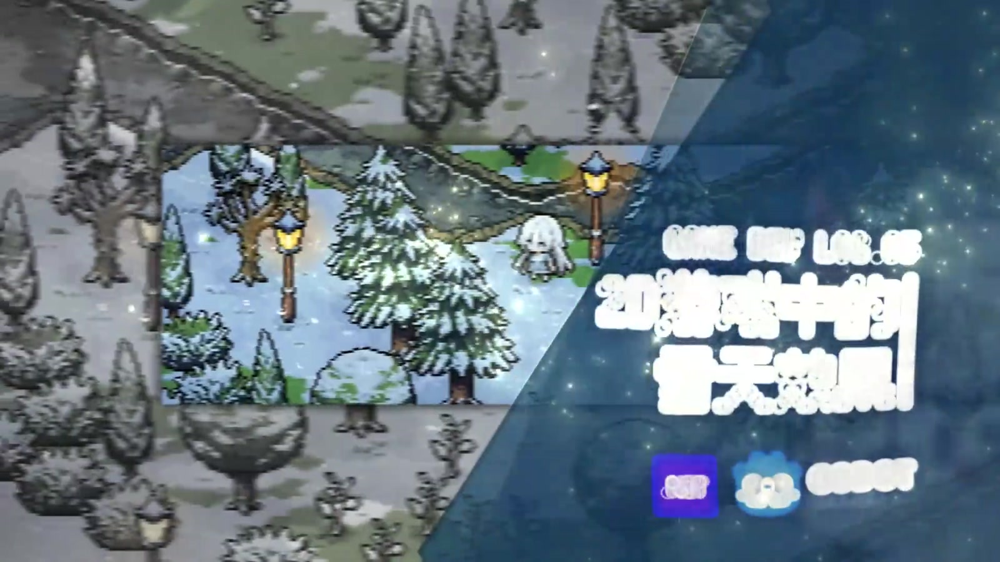

整个效果由两部分组成——空中飘的雪粒子，和地面/物体上积起来的雪。视频后半段才做后者，前半段全部是粒子。

### 2. 雪花贴图只有 3×3 像素（00:03 – 00:06）

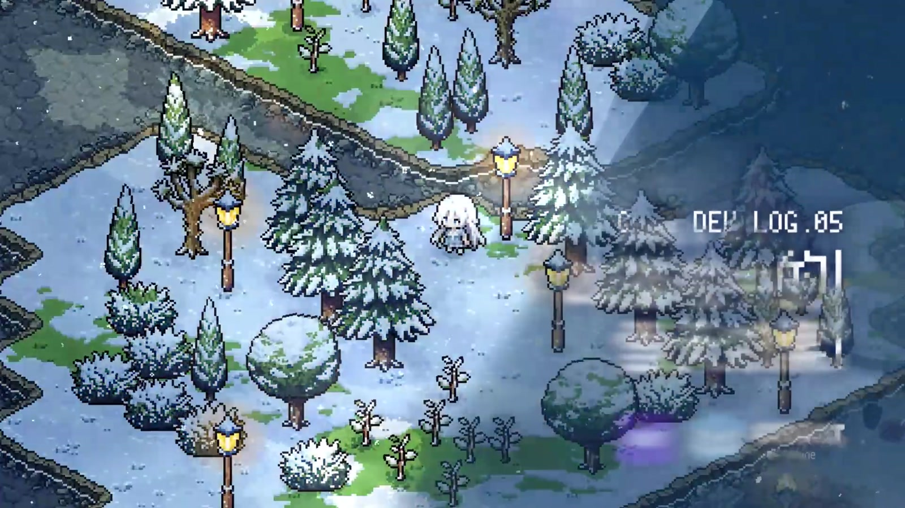

贴图不是一张大图，而是 **9 张 3×3 像素**的小图拼成一张 9×9 画布。像素越小、越"糊"，反而越像 2D 游戏里的雪——这类项目里"画得糙"是有意的风格选择。

### 3. GPUParticles2D + 粒子材质（00:47）

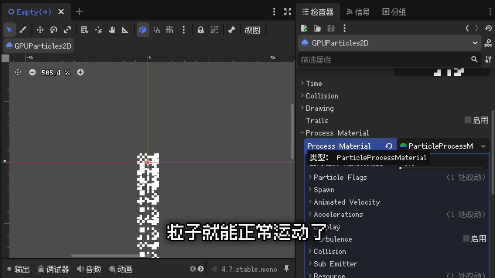

光有贴图不会动，必须给它一个 **Process Material**；不建这个，`GPUParticles2D` 什么都不画。

### 4. 动画帧：让每片雪随机选一格（01:01）

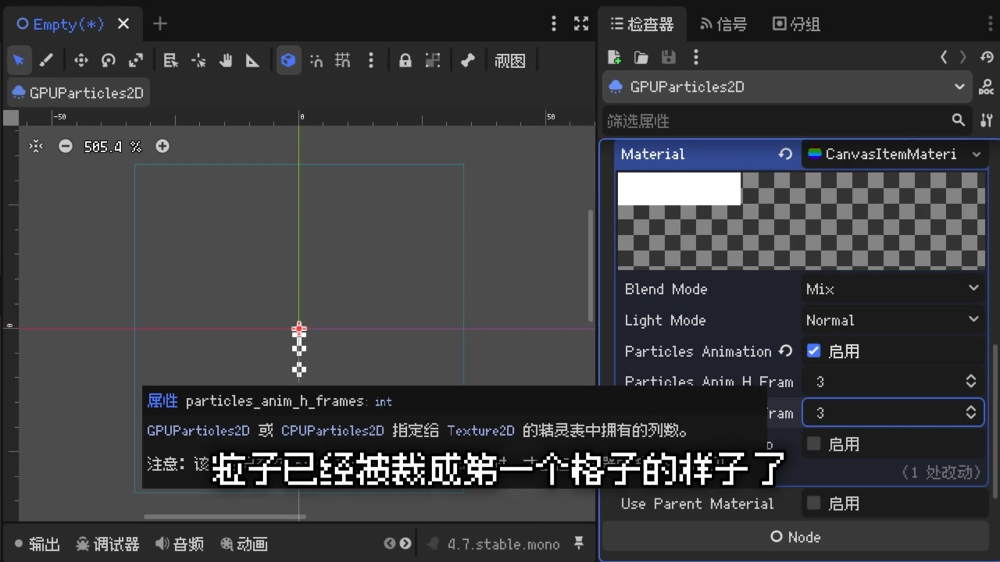

这一步是"图集"的关键：`CanvasItemMaterial` 里勾 `Particles Animation`，`hframes = 3`、`vframes = 3` 告诉引擎这张图切成 3×3。此时所有粒子都显示第 1 格——所以还要下一步把 Offset 拉满。

### 5. 一个参数搞定随机（01:18 – 02:03）

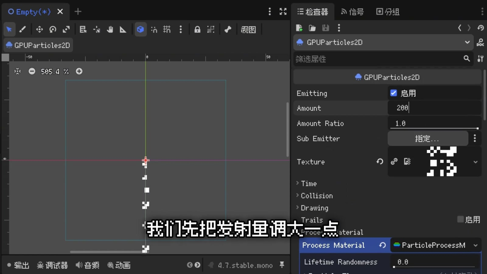

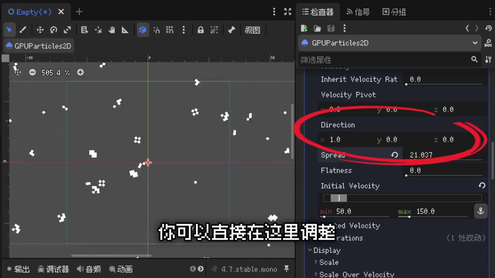

`Display → Animation → Offset` 的**最大值拉到最右**，粒子出生时就会在 9 格里随机取一张。再配合：

- 重力清零（雪不是往下砸的）
- Emission Shape = Box + 范围（让雪在整个屏幕上出现，而不是一个点）
- 初始旋转 0~360°（避免所有雪花朝向一致）
- 初速 50~150 + 压小 Spread（有速度差才自然，方向别散太开）

### 6. 淡入淡出靠 Alpha 曲线（02:58）

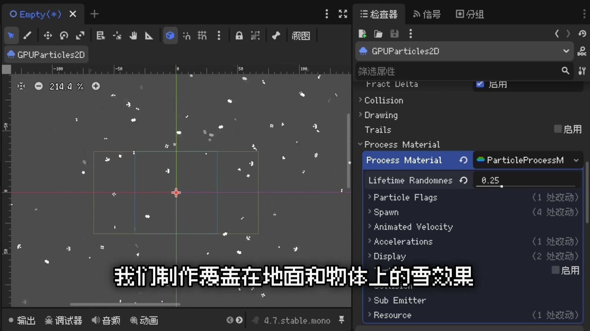

粒子"凭空出现、凭空消失"最假。在 `Color Ramp` 的 **Alpha Curve** 上做一条从 0 升到 1 再降回的曲线，出生和消亡就软掉了。同时把 `Time → Lifetime` 调长，雪才不会刚飘两下就没了。

> 作者的态度值得记一句：*"所有参数都是看着画面调到自己看着舒服的值就行，不用太拘谨。"*

### 7. 地面积雪：噪波 + Step（03:12 – 03:22）

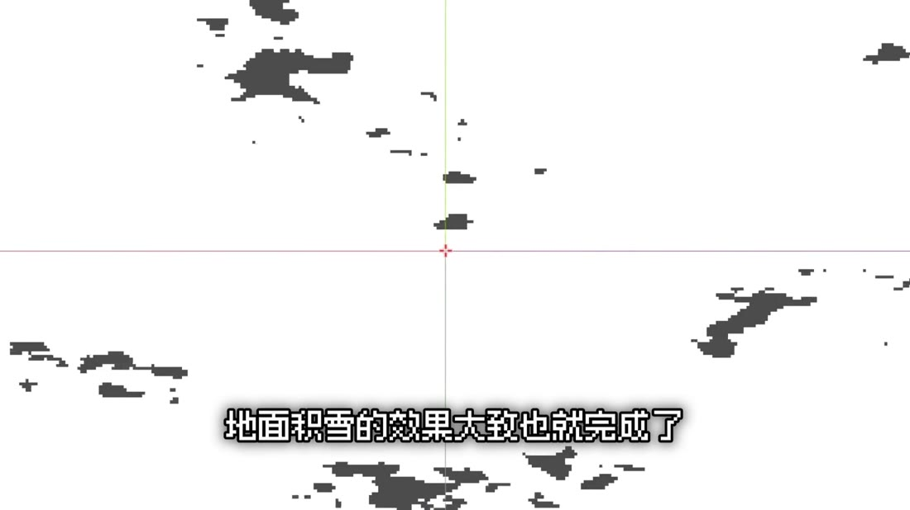

这部分跟粒子完全无关，是一张覆盖全屏的 shader：

```
噪波贴图 → Step(threshold) → UV 像素化 → 当作蒙版
```

`Step` 的阈值就是**积雪厚度**：阈值低 → 雪多，阈值高 → 雪少。所以"雪慢慢堆起来 / 化掉"只是给这一个值做动画，不需要换贴图。

UV 像素化是为了让积雪的边缘跟游戏的低分辨率像素风格对齐，否则矢量化的噪波边缘会很"高清"、跟场景不搭。

### 8. Mix 成最终画面（03:36 – 04:00）

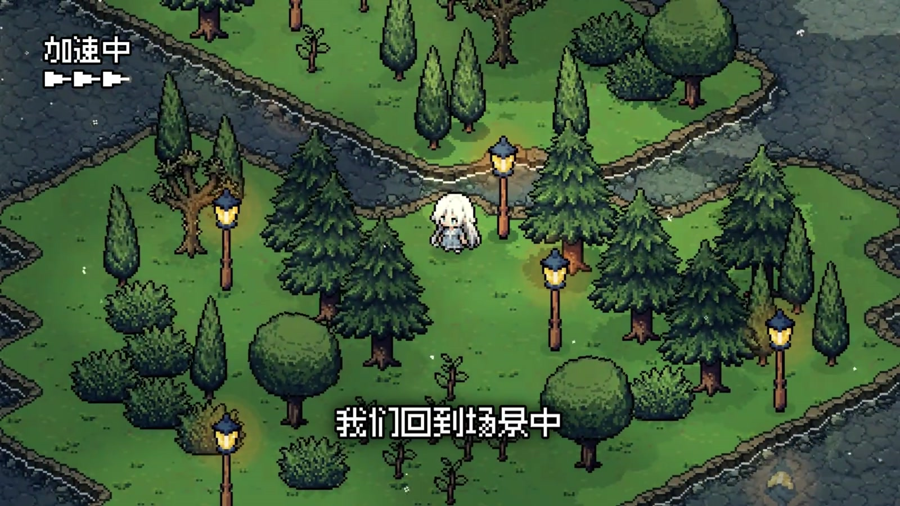

把上一步的结果当蒙版，`Mix(原贴图, 积雪贴图, 蒙版)`，就得到树上有雪、地上有雪的画面。物体上的积雪用同一套方法，不需要另写一套。

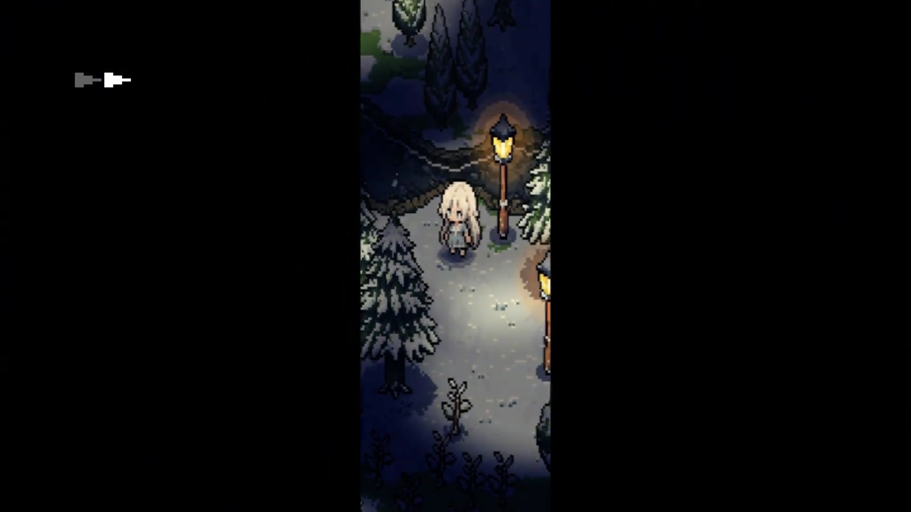

## 可抄参数表

| 环节 | 参数 / 值 |
|---|---|
| 雪花贴图 | Aseprite 9×9 画布，9 张 3×3 像素小图 |
| 节点 | `GPUParticles2D` + `ParticleProcessMaterial` + `CanvasItemMaterial` |
| 图集切分 | `Particles Animation` 勾选，hframes = 3，vframes = 3 |
| 随机取图 | `Display → Animation → Offset` 拉到最大值 |
| 重力 | 0 |
| Emission Shape | Box + 按需扩展范围 |
| 初始旋转 | 0 ~ 360° |
| 发射量 | Amount = 200 |
| 初始速度 | 50 ~ 150，Spread ≈ 21（按需下调） |
| 飘向 | `Direction`（可运行时按风向动态设置） |
| 淡入淡出 | `Color Ramp → Alpha Curve`（1 全显 / 0 全隐） |
| 生命 | `Time → Lifetime` 调长 |
| 地面积雪 | 噪波 → `Step`（阈值 = 积雪量）→ UV 像素化 → 当蒙版 |
| 合成 | `Mix(原贴图, 积雪贴图, 蒙版)` |

## 关键帧总览

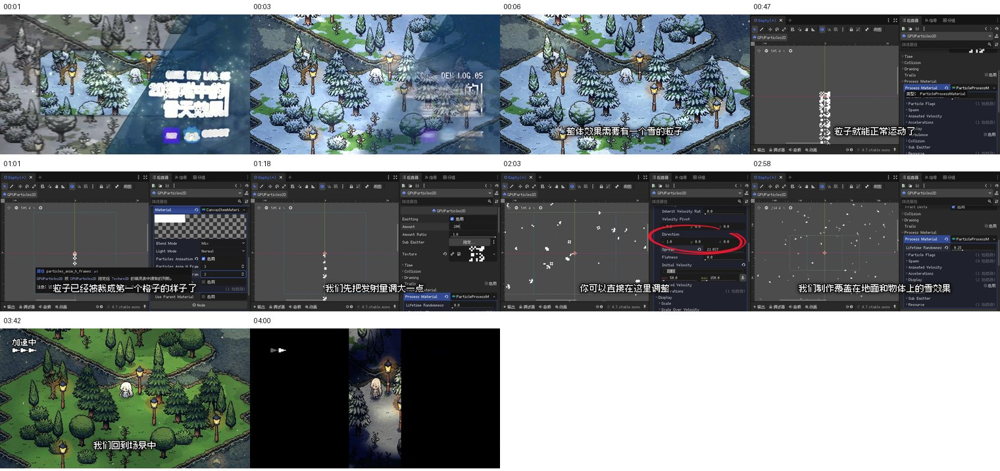

## 可以直接带走的三条经验

1. **粒子归粒子、积雪归 shader**：一个是发射器参数，一个是全屏蒙版，两者完全不耦合，分开调很快就出效果。
2. **"厚度"是一个数值，不是一张图**：Step 阈值一动，积雪就堆起来或化掉，做季节变化/动态天气几乎零成本。
3. **像素化是风格统一的手段**：噪波本身太"高清"，UV 像素化之后才和 2D 像素游戏同框不违和。

---

完整口播文字稿（带时间点）见 `transcript.md`。
