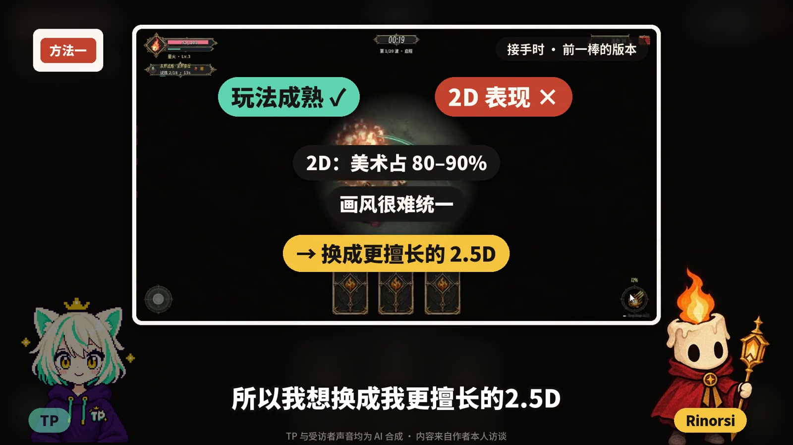
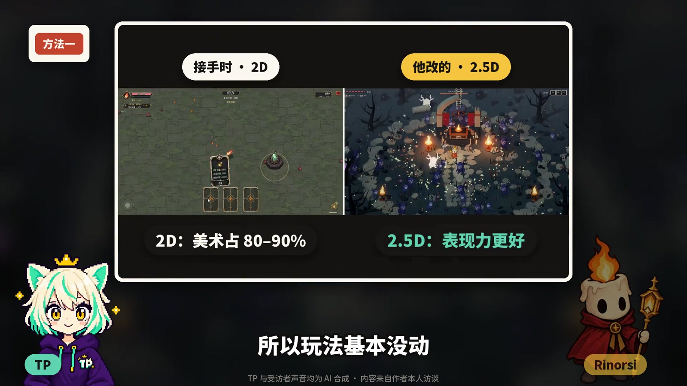
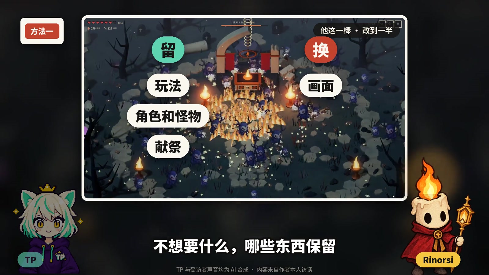
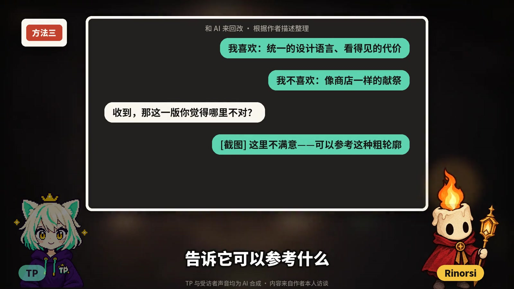
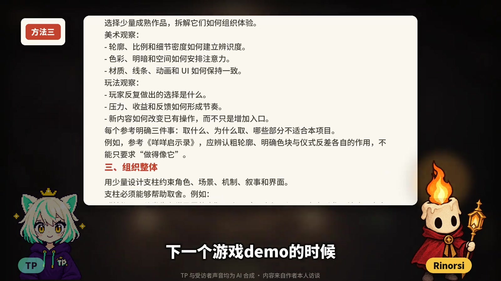
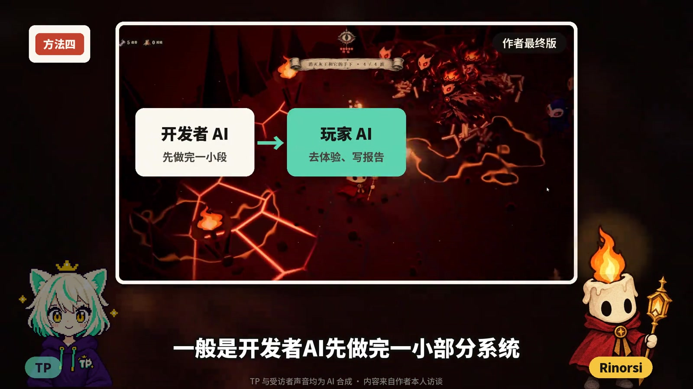
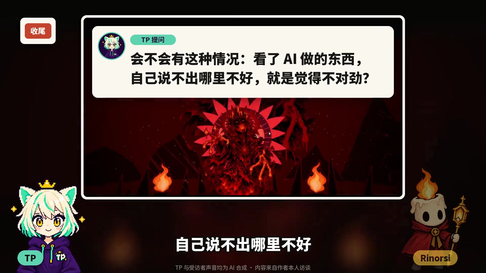
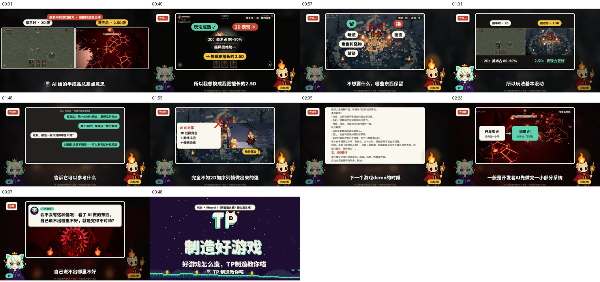

# 4 招抢救 AI 半成品 —— 不推倒重来，把"差点意思"拆成可改的点

> 栏目 **tp 制造好游戏** ｜ 受访 **Rinorsi（云诺羲）** ｜ 时长 **03:51** ｜ 抖音 ｜ 点赞 4560 · 收藏 3485
> 原视频：https://www.douyin.com/video/7709727096804887846
> 案例：《烬谷盗火录》——朋友间游戏接力的作品，仍在打磨

## 一句话概括

半成品别急着重做：**先定位到"到底哪块不满意"，再让 AI 反问你想要什么，然后用"我喜欢/我不喜欢 + 截图指参考"逐点修正，最后用多个 AI 交叉验收**——因为你越批评，AI 越谄媚，必须放一个中立裁判。这套挑剔的沉淀物就是 **taste 文档**。

## 30 秒版要点

- **接手时先判断"哪块不行"**：玩法成熟 ✓、2D 表现 ✗ → 玩法基本不动，**只重做画面**，并且换成更擅长的 **2.5D**。
- **2D 的坑在成本**：2D 美术占 80~90%，**AI 现在很难保证整个游戏画风统一**；2.5D 表现力更好、更好控。
- **方法一：先定位，不动手**。先写清"想要什么 / 不想要什么 / 保留什么"。
- **方法二：让 AI 先问你**。"第一眼想让玩家有什么感觉？"——作者答"**可爱但不安**"。项目文档写得再明确，AI 也会理解偏差。
- **方法三：说清喜恶 + 截图指参考 + 沉淀台账**。"我喜欢统一的设计语言、看得见的代价；我不喜欢像商店一样的献祭"；不满意就**逐处截图**并给参考图；做完**让它整理今天否决了哪些设计、为什么否决、弊端是什么**，下个项目先读这份文档。
- **方法四：多 AI 交叉验收**。开发者 AI 做一小段 → 玩家 AI 去体验写报告 → **第三个 AI 当裁判**判断双方优劣再发回去。理由只有一句：**"AI 最大的问题就是谄媚"**。
- **实在说不上来哪里不对** → 找五六个人玩一圈，综合意见。

## 四招拆解

### 背景：一个"玩法好、画面烂"的半成品（00:49）



作者拿到的是一棒接力的半成品。他的判断非常干脆：

| 维度 | 判断 |
|---|---|
| 玩法 | **成熟**，基本没动 |
| 2D 表现 | **不行** —— 2D 美术占比 80~90%，画风很难统一 |
| 结论 | 换成自己更擅长的 **2.5D** |



注意这个决策顺序：**先判断美术成本，再决定技术形态**，而不是先选个喜欢的形式再硬凑。2D 的真实成本不是"画得累"，而是**AI 出图的一致性撑不住 80~90% 的美术占比**。

### 方法一：先定位哪块不满意，再动手（00:57）



作者的第一个动作不是打开编辑器，而是**写清三件事**：

1. 我想要什么
2. 我不想要什么
3. 哪些东西保留、哪些不保留

> 「第一步不是动手改，是先找到到底哪块不满意。」

### 方法二：让 AI 先问你，再让它干（01:09）

> 「项目做多了就会知道，它最开始会给你做成一大坨，哪怕你文档写得很明确，它也会有理解偏差。**所以我都是让 AI 先问我要做成什么样子。**」

他给 AI 的第一个问题不是需求，而是**感受**：

> **"第一眼想让玩家有什么感觉？"** → "可爱但不安"

这一步的作用是把"审美判断"提前暴露出来。否则 AI 会先猜一个方向、做一大堆、然后你只能说"不对"。

### 方法三：说清喜恶 + 截图指参考 + 沉淀台账（01:48）



对话结构非常值得抄：

| 说话人 | 内容 |
|---|---|
| 作者 | 我喜欢：**统一的设计语言、看得见的代价** |
| 作者 | 我不喜欢：**像商店一样的献祭** |
| AI | 收到，那这一版你觉得哪里不对？ |
| 作者 | **[截图] 这里不满意——可以参考这种粗轮廓** |

三个关键动作：**说喜恶**（而不是说"不好看"）、**截图定位**（而不是笼统描述）、**给参考**（而不是让 AI 自由发挥）。

一个具体教训：最初 AI 想把角色做成 3D，但工期短，它只能给出一堆方块小人——**完全不如 2D 加序列帧**。所以"不喜欢"之后必须补上"应该是什么样"。

#### 台账：让它总结"否决了什么"



每做完一个项目，作者会让 AI 整理**今天否决了哪些设计、为什么否决、弊端是什么**，存成文档。下一个 demo 开始时第一句话是：

> "你先读一下这个文档。如果你坚持用这些设计，请告诉我能做得更好的点。"

> 「每次不成功都有价值，积累多了就是你的 **taste**。」

### 方法四：多个 AI 交叉验收（02:23）



流程：

```
开发者 AI 做一小段系统
      ↓
玩家 AI 去体验，写一份报告
      ↓
第三个 AI 当裁判，判断两份报告各自的优劣
      ↓
分别发回给前面两个 AI
```

**为什么非要第三个 AI？**

> 「因为 AI 最大的问题就是**谄媚**。」

原话的例子很典型：如果直接把玩家 AI 的抱怨转给"制作人 AI"，它一定会说"你说得对，这个地方确实有问题，让我看看怎么改"。**它不判断，它只顺着你。**

#### 案例：献祭机制

| 角色 | 意见 |
|---|---|
| 开发者 AI | 这个设计有风险也有收益 |
| 玩家 AI | 那我发现不献祭更容易通关，我就不献祭了呗 |
| 作者（拍板） | 献祭是这一棒的主题，**不能删，只能改到让人愿意去献祭** |

这条最能说明"裁判 AI"的价值：**玩家 AI 会本能地优化通关效率，而设计意图需要有人守住**。

#### 兜底：找真人



如果连自己都"说不出哪里不对、就是觉得不对劲"，那就**找五六个人玩一圈**，大家总能说出来，再综合意见。

## 附：taste 文档长什么样（02:05）

这才是这条视频最值钱的部分（评论区置顶有完整版）。文档结构如下：

```text
选择少量成熟作品，拆解它们如何组织体验。

美术观察：
- 轮廓、比例和细节密度如何建立辨识度。
- 色彩、明暗和空间如何安排注意力。
- 材质、线条、动画和 UI 如何保持一致。

玩法观察：
- 玩家反复做出的选择是什么。
- 压力、收益和反馈如何形成节奏。
- 新内容如何改变已有操作，而不只是增加入口。

每个参考明确三件事：取什么、为什么取、哪些部分不适合本项目。
例如参考《咩咩启示录》，应辨认粗轮廓、明确色块与仪式反差各自的作用，
不能只要求"做得像它"。

三、组织整体
用少量设计支柱约束角色、场景、机制、叙事和界面。
支柱必须能够帮助取舍。
```

三个要点：

1. **参考要拆到"机制"层**，不是抄表面："粗轮廓、明确色块、仪式反差各自起什么作用"。
2. **每个参考必须明确"不取什么"**——否则会把不适用的东西一起搬进来。
3. **用少量设计支柱做取舍**，支柱的作用是"帮你否决"，不是"帮你描述"。

## 四招速查

| # | 招式 | 一句话 | 反例（不做会怎样） |
|---|---|---|---|
| 一 | 先定位 | 写清想要/不想要/保留什么，再动手 | 边改边想，越改越乱 |
| 二 | 让 AI 先问 | 先对齐"第一眼要给什么感觉" | AI 猜错方向，产出"一大坨" |
| 三 | 说喜恶 + 截图 + 台账 | 具体到点、给参考、沉淀否决清单 | 只说"不好看"，AI 反复谄媚重试 |
| 四 | 多 AI 交叉验收 | 开发者 / 玩家 / 裁判三角 | 自己逐个验收，被 AI 的顺从骗过去 |

## 关键帧总览



## 可以直接带走的三条经验

1. **"抢救"比"重做"省的是判断力，不是工时**：作者几乎没改玩法，只换表现形态；真正的活是把"哪里不对"拆成可执行的点。
2. **对 AI 的挑剔要写成资产**：每次否决的理由都会变成下个项目的约束条件——这就是 taste，也是 AI 时代个人最硬的护城河。
3. **别让 AI 既当选手又当裁判**：它的默认行为是顺着你。要么放一个中立 AI 判优劣，要么找真人玩一圈。

---

完整口播文字稿（带时间点）见 `transcript.md`。
