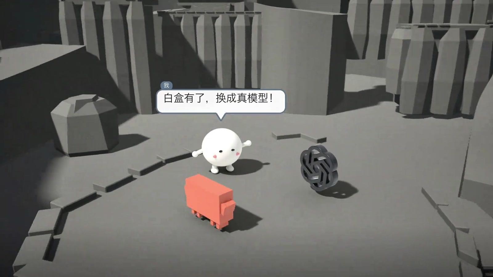
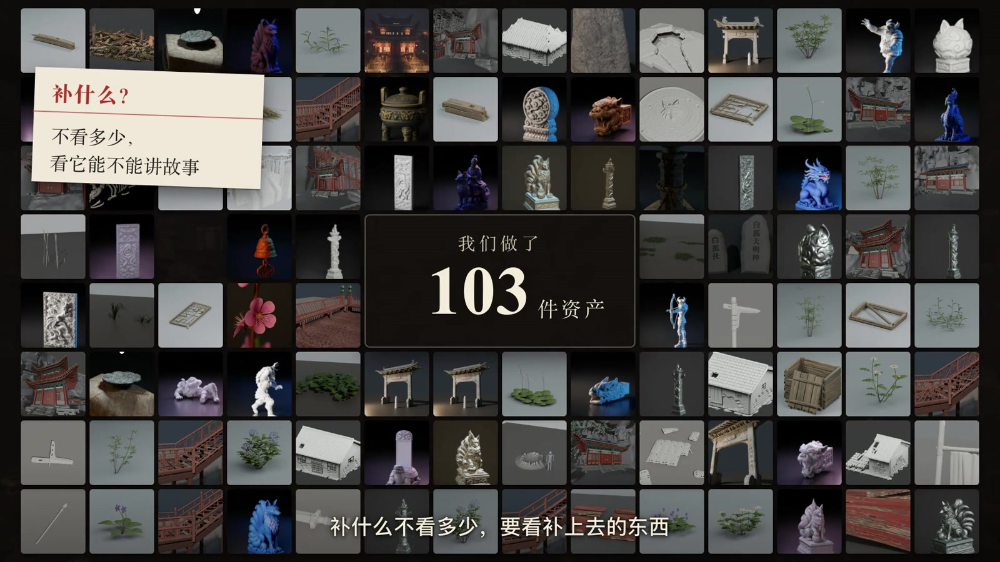
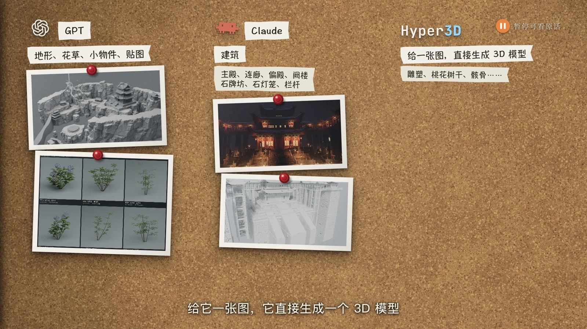
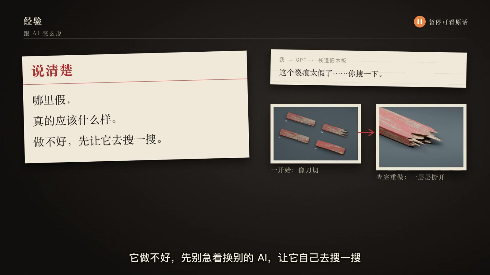
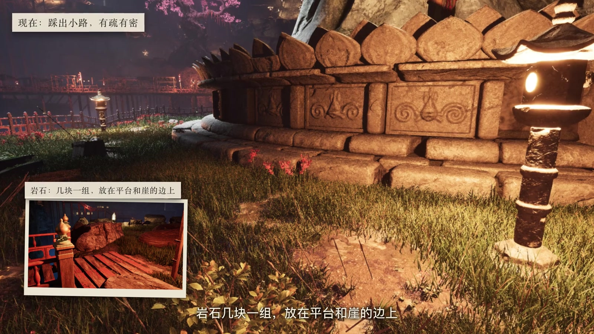
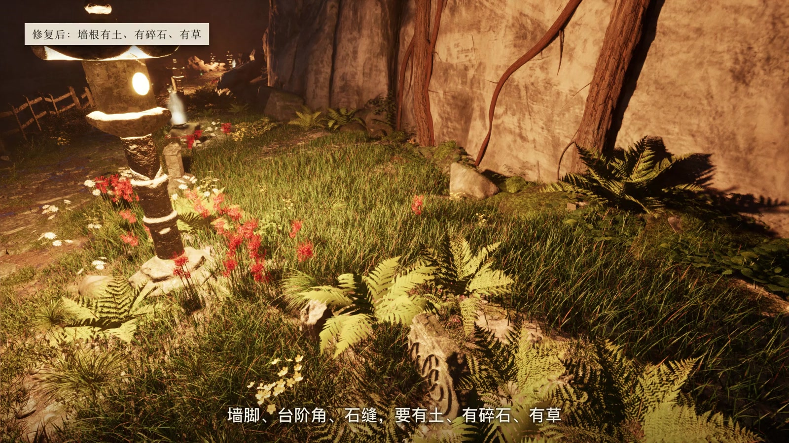
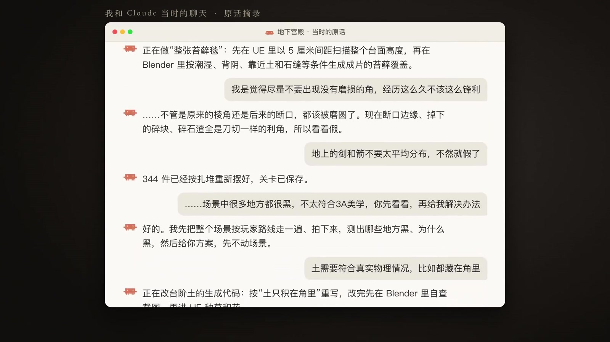
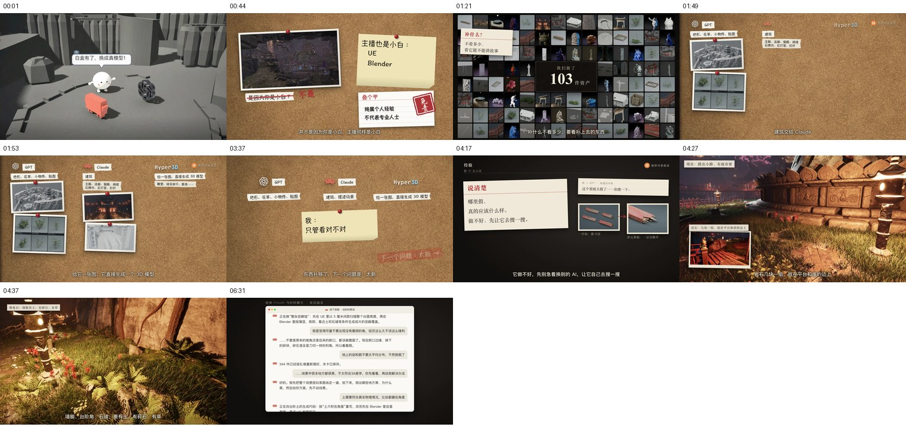

# AI 做的场景为什么一眼假？—— 四件事把白模救回来

> 作者 **糯米鱼丸（Ai版）** ｜ 时长 **06:36** ｜ 抖音 ｜ 点赞 7148 · 收藏 4432 · 评论 133
> 原视频：https://www.douyin.com/video/7710984439119340518

## 一句话概括

"假"不是 AI 建不出东西，而是**东西太少、太新、摆得太整齐、光没有来源**；于是优化只有四件事——**按故事把东西补够 → 做旧 → 摆得像真的 → 打上有来源的光（加雾）**。全程作者只做两件事：定一句话设定、指出哪里假；剩下的建模、贴图、摆放全交给 GPT / Claude / Hyper3D。

## 30 秒版要点

- **判据不是"补多少"，而是"补上去的东西能不能讲出这里发生过什么"**。作者给宫殿定了一句话：*这里打过仗，后来荒了很久*。
- **按故事列清单**：打过仗 → 兵器、弹坑、石化妖兵、骸骨；荒很久 → 积土碎石、青苔野草、彼岸花。
- **按能力分工**：地形/花草/小物件/贴图 → GPT；建筑 → Claude；形状复杂的雕塑/树干/骸骨 → **Hyper3D（给一张图直接生成 3D 模型）**；摆放 → Claude；**"我：只管看对不对"**。
- **提示词铁律**：**一张图只画一个物件**、**浅灰背景不要投影**——背景和影子会被当成形状一起做进模型。
- **做旧靠具体描述**：旧木板不能"像一刀切"，要"一层层撕开、带木纤维和细木刺"；棱角要磨圆，掉皮用贴图别硬建模。
- **摆放三条**：**扎堆**（有疏有密、踩出小路）、**落地**（埋进土里、骨头下有土堆）、**交界过渡**（墙根/台阶角/石缝要有土、碎石、草）。
- **先开全局光照**：不开时暗处被整体提亮，**石头像飘在空中**；开了光在墙与地面之间反弹，石头才落地。变死黑时**别整体调亮，哪里黑就在哪放一个说得通的光源**。
- **对话的姿态**：做不好先别换 AI，**让它自己去搜一搜**再重做。

## 分步拆解

### 1. 起点：一眼简陋的白模（00:01）

作者先自己"叠甲"：不是专业人士，UE、Blender 都不会。这个前提很重要——**后面所有优化动作都不是调参数，而是"看 + 说"**。

上期的工作流：**GPT 出图搭白膜 → Claude 搭场景 → 作者只看和拍板**。这期继续这条线，开始做细。

### 2. 补什么，看能不能讲故事（01:21）

整段最核心的判据：

> 补什么**不看多少**，要看补上去的东西**能不能讲出这里发生过什么**。

于是先定一句设定，让设定自动推导清单：

| 设定 | 推导出的物件 |
|---|---|
| 这里打过仗 | 兵器、弹坑、石化的妖兵、骸骨 |
| 后来荒了很久 | 积土碎石、青苔、野草、彼岸花 |

**先有故事，再有资产列表。** 这一步不需要任何 3D 技能，只需要写一句话。

### 3. 分工：谁擅长什么就交给谁（01:53）

| 环节 | 交给谁 | 具体内容 |
|---|---|---|
| 地形、花草、小物件、贴图 | **GPT** | 先出效果图 → 点头 → 白模 → 贴图 |
| 建筑 | **Claude** | 主殿、连廊、偏殿、阁楼、石牌坊、石灯笼、栏杆 |
| 复杂形状 | **Hyper3D** | 雕塑、桃花树干、骸骨…… 给一张图直接生成 3D 模型 |
| 摆进场景 | **Claude** | 最终所有东西由它摆 |
| 判断对不对 | **作者** | "我只用鼠标挪过几块岩石" |

**地形要多几步**，这是整段最实操的流程：

1. 效果图定稿后，让 AI **把房子、石像这些资产全去掉**，出一张只剩地形的净版
2. 再出**俯视图**，把地形一层一层拆开标注
3. 每一块单独出**白膜图**：不要颜色，只看形状，**顶视 / 侧视 / 背视都出**
4. 拿这些图让 AI 去 Blender 建模

改岩壁同理：先说哪里不对（"不要钟乳石"）→ GPT 生图定标准 → 照图建白膜 → 放进 UE → 最后把太硬的边修软。

### 4. 提示词的两条铁律（03:05）

给 Hyper3D 生成模型的图必须遵守：

- **一张图只画一个物件**（多个物件会糊成一个）
- **浅灰背景、不要投影**（背景和影子会被当成形状做进模型里）

还有一条省事技巧：**需要贴图就让 AI 自己出**。Claude 建的东西要贴图，直接写需求发给 GPT，"我连话都不用传"——雕像台座上那一大片青苔就是 GPT 自己做的。

### 5. 做旧：把"哪里假"说具体（04:17）

三个病例，句式都是"哪里假 → 真的什么样"：

| 假的表现 | 应该怎样 |
|---|---|
| 方盒子简模、棱角太硬 | 棱角磨圆，经历这么久不该这么锋利 |
| 掉皮也硬建模 | 掉皮用**贴图**做 |
| 旧木板裂口像一刀切 | 断口**一层层撕开**，带木纤维和细木刺 |

木板那张对比图是全片最有说服力的例子：作者没有说"重做"，而是说*"这个裂痕太假了，你搜一下"*——**先让它补知识，再重做**。原则：

> 跟 AI 说话要说清楚"哪里假、真的应该什么样"；**它做不好先别急着换别的 AI。**

### 6. 摆放三条（04:27 – 04:37）

| 规则 | 具体做法 |
|---|---|
| **扎堆** | 有疏有密。剑和箭不要平均分布，有的地方插成一片、有的地方空着；岩石几块一组，靠在平台和崖的边上 |
| **落地** | 东西埋进土里，骨头底下要有土堆 |
| **交界过渡** | 墙角、台阶角、石缝要有土、有碎石、有草 |

作者原话：这三条**不是一开始就懂的，是一处处看着不对挑出来的**。核心直觉只有一条——**整齐就是假**。

### 7. 放进游戏里再删一遍（04:44）

不协调的**直接删**，不是修：

- 几十种植物里挑出 **4 种不搭的**，从项目里删干净
- 主殿上一大片藤蔓，建模软件里看着挺好，**进了游戏特别假** → 全删
- 假花草突然发白、叶子反光太强 → 压下去

唯一标准是**进游戏后的观感**，不是资产浏览器里的截图。

### 8. 光：最后一步，也最要命（05:09）

**第一步必须开全局光照**，理由很具体：

- 不开：暗处被整体提亮，**石头像飘在空中**
- 开了：光在墙和地面之间来回反弹，**石头一下就落了地**

**第二步解决"死黑"**：不要整体调亮，而是**哪里黑就在哪里放一个说得通的光源**——灯笼、宫灯、石灯笼、狐火灯，光要柔；再加雾，雾让远处退后，洞顶的光打下来才有光柱。

补光清单（可以直接照做）：

- 前景留一点暗
- 岩壁打一盏大光
- 远处的房子挂上灯
- 挂不了灯的地方补一盏**看不见的光**
- 三个小坑没地方挂灯 → 借**湖面反光**
- 崖壁岩石贴图太黑 → 先把颜色调回正常
- 洞顶缝里漏光 → 堵上

### 9. 真正的干货：和 Claude 的原话（06:31）

这一屏是整段最值得暂停看的部分，作者的指令全是**带量化条件的白话**：

| 作者怎么说的 | Claude 怎么做的 |
|---|---|
| "整张苔藓毯" | UE 里以 **5 厘米间距**扫描整个台面高度，再在 Blender 里按**潮湿、背阴、靠近土和石缝**等条件生成成片覆盖 |
| "经历这么久不该这么锋利" | 原来的棱角、后来的断口都磨圆——"现在断口边缘、掉下的碎块、碎石渣全是刀切一样的利角，所以看着假" |
| "地上的剑和箭不要太平均分布" | **344 件**已按扎堆重新摆好，关卡已保存 |
| "很多地方都很黑，不太符合 3A 美学，你先看看，再给我解决办法" | 先按玩家路线走一遍、拍下来，**测出哪些地方黑、为什么黑**，再给方案，**先不动场景** |
| "土要符合真实物理，比如都藏在角里" | 重写台阶土的生成代码，**改完先在 Blender 里自查截图**，再进 UE 建景 |

注意最后两条体现的协作方式：**先诊断、再动手**；**改完先自查，再进主工程**。

## 四件事总结

| 病症 | 根因 | 对策 |
|---|---|---|
| 东西太少 | 没有故事 | 一句话设定 → 列物件清单 → 补够 |
| 太新 | 没有磨损痕迹 | 磨圆棱角、掉皮用贴图、断口要拉丝 |
| 摆得假 | 太整齐、没落地、没有过渡 | 扎堆 / 埋进土里 / 交界铺土石草 |
| 光不行 | 没有来源 | 开全局光照 → 就地放光源 → 加雾 |

> **"AI 能帮你把东西做出来，但哪里假得你自己看出来，再一句一句告诉它。"**

## 关键帧总览

## 可以直接带走的三条经验

1. **"假"是四个独立问题，别混着治**：内容不够、状态太新、秩序太整齐、光没来源。一次只治一个，改完立刻回游戏里看。
2. **把判断留给自己，把生产交给 AI**：定一句话设定 + 指出哪里假，就是作者的全部工作。这是 AI 时代场景美术的真实分工。
3. **对话质量 > 工具选择**：与其换更贵的模型，不如把"真的木头断开有拉丝"说清楚，并让它自己去搜参考；指令里带上量化条件（5 厘米间距、344 件、按玩家路线走一遍）效果最好。

---

完整口播文字稿（带时间点）见 `transcript.md`。
