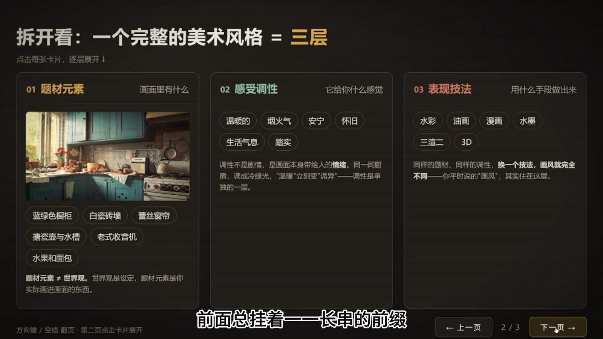
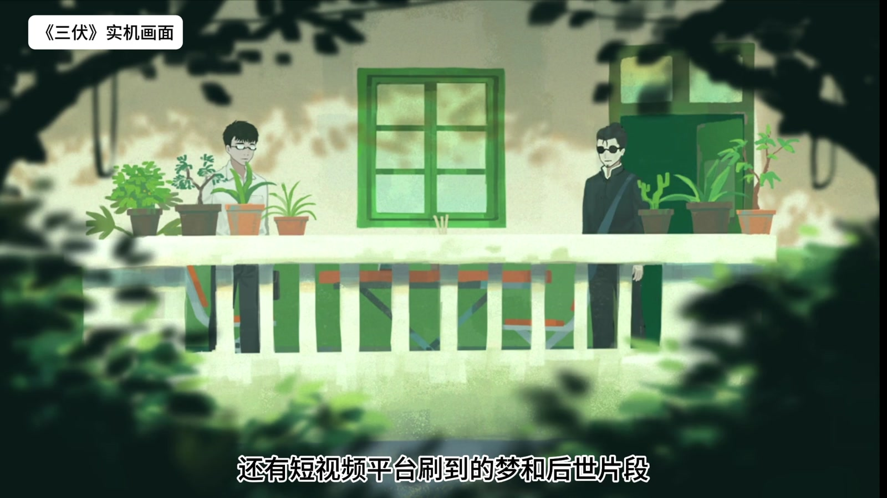
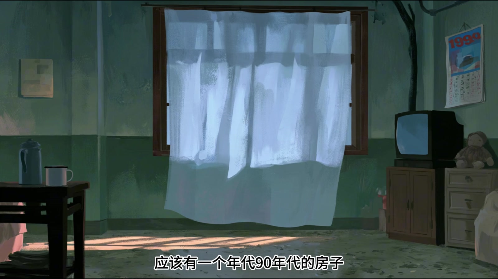
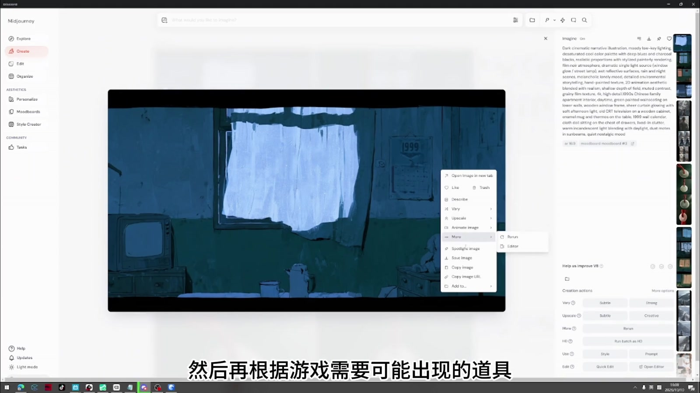
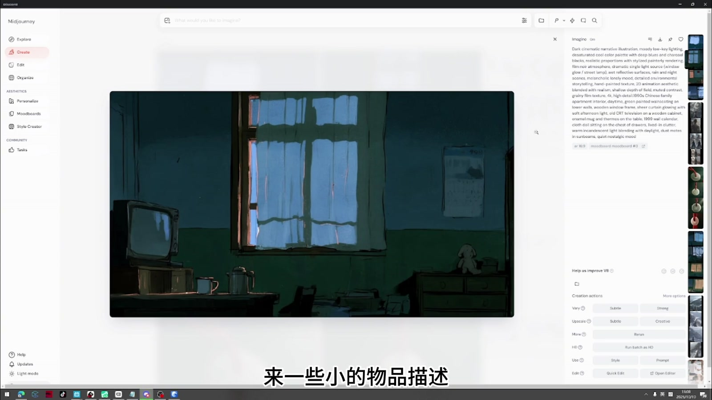
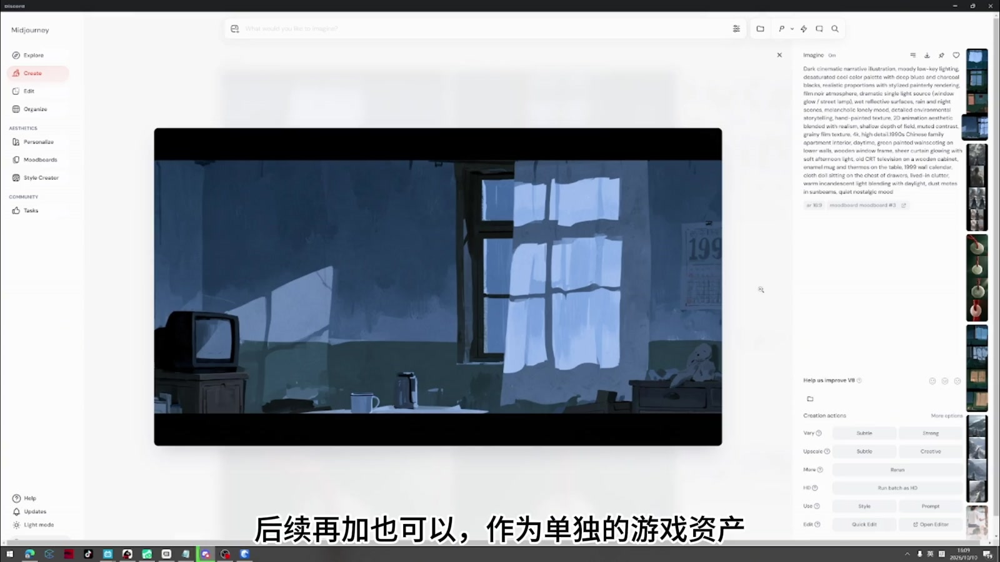
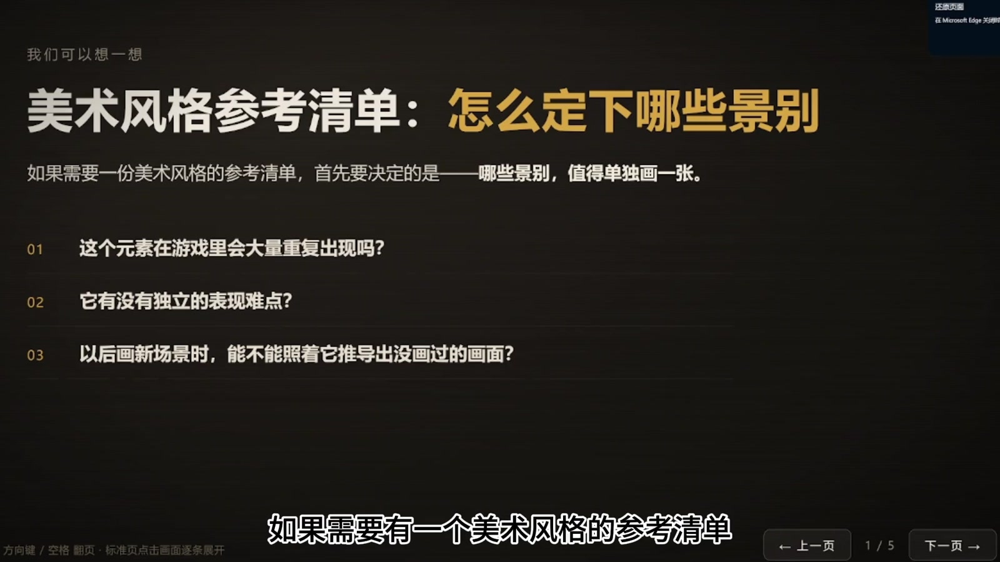
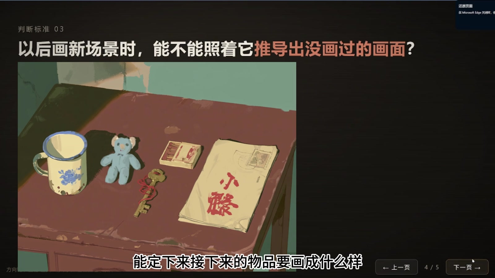
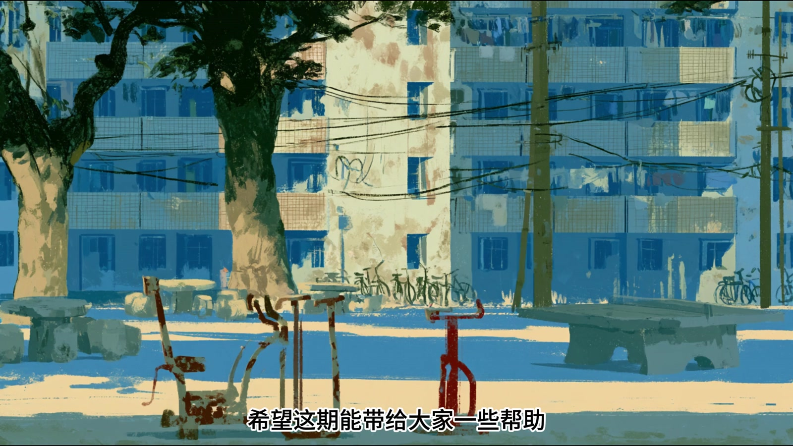
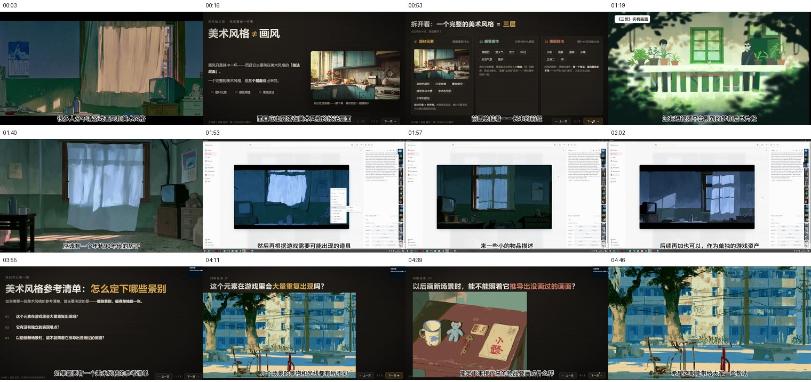

# AI 游戏美术：风格 ≠ 画风 —— 美术风格怎么确定？

> 作者 **野路子游戏车间（K 米）** ｜ 时长 **04:48** ｜ 抖音 ｜ 点赞 3767 · 收藏 2983
> 原视频：https://www.douyin.com/video/7695768004130344202

## 一句话概括

**美术风格 = 题材元素 × 感受调性 × 表现技法**，三层叠加才算完整；你平时说的"**画风**"只住在第三层（技法）里。所以定风格不是"选一个画风"，而是把三件事各自从模糊问成具体——最后再用三问筛出"哪些景别值得单独画一张"。

## 30 秒版要点

- **画风 ≠ 美术风格**。画风只是"用什么手段做出来"这一层；只谈画风，等于只做了三分之一的活。
- **三层**：`01 题材元素`（画面里有什么）｜ `02 感受调性`（它给你什么感觉）｜ `03 表现技法`（用什么手段做出来）。
- **题材元素 ≠ 世界观**。世界观是设定，题材元素是**实际画进画面的东西**。
- **调性 ≠ 剧情**。调性是画面本身带给人的情绪：同一间厨房调成冷绿光，"温暖"立刻变"诡异"。
- **换技法，画风就完全不同**：同样题材、同样调性，水彩/油画/三渲二/3D 出来的就是四种东西。
- **三层没有先后**，从哪层进都行，但最后要"三层都到位"才算定下来。
- **参考清单只画值得画的**：用三问筛景别（会不会大量复现 / 有没有独立表现难点 / 能不能用来推导没画过的画面）。

## 分步拆解

### 1. 先对齐概念（00:16）

作者开门见山地指出这个词被混用：**很多人把"画风"当成了"美术风格"的全部**。而一个完整的美术风格，是三面叠出来的。

### 2. 拆开看：三层各管什么（00:53）

这张图是全片的骨架，值得逐格读：

| 层 | 提问 | 内容 | 说明 |
|---|---|---|---|
| **01 题材元素** | 画面里有什么 | 蓝绿色橱柜、白瓷砖墙、蕾丝窗帘、搪瓷壶与水槽、老式收音机、水果和面包 | **≠ 世界观**。世界观是设定，题材元素是你实际画进画面的东西 |
| **02 感受调性** | 它给你什么感觉 | 温暖的、烟火气、安宁、怀旧、生活气息、踏实 | **≠ 剧情**。是画面本身带的情绪；同一间厨房调成冷绿光，"温暖"立刻变"诡异" |
| **03 表现技法** | 用什么手段做出来 | 水彩、油画、漫画、水墨、三渲二、3D | **你平时说的"画风"，其实住在这层** |

这也解释了那句老话为什么成立——**聊美术风格时前面总挂着一长串前缀**（"90 年代中国南方小城的、潮湿的、水彩质感的……"），因为它是三层叠加出来的复合描述，不是一个词能概括的。

### 3. 实操：给一个选题（01:19）

作者设的题目：**一款章节式的现代民俗怪谈游戏**。

他先不写文档，而是先抓"感觉"——脑子里蹦出的三幅场景 + 平时刷到的**梦核、后室**片段。这些东西表面不搭，但**情绪底色是同一个：隐隐的不安，平静里透着不对劲**。

> 这一步其实是先确定第 02 层（调性），再倒推 01 和 03。作者强调过三层没有先后，从哪层进都行。

#### 第 1 问：画面里有什么

落到具体：**90 年代的房子** → 绿色的墙皮、木窗框、窗帘有一点透光。

先定大环境，小物件（道具）后面再补——**补上来的物件也可以作为单独的游戏资产复用**。

#### 第 2 问：它给你什么感觉

这一步落到**美术原理**：颜色是冷是暖、明度是明是暗，直接决定基本感受和构图。

方法论是"**找参照物 + 拆原理**"：作者觉得梦核/后室视频的观感和自己要的相通，就去分析**它为什么给我这种感觉**，再把背后的原理用到自己画面里。

> 关键提示：**这些知识不需要你从头掌握，可以和 AI 讨论**——你只负责判断哪些能用、哪些不能用。

#### 第 3 问：画风

画风的选择受三种力量拉扯：

| 力量 | 具体表现 |
|---|---|
| 题材惯性 | 这个题材已有成功画风 → 可以做**模仿** |
| 差异性 | 这个题材画风太多太普遍、做不出差异 → 反而要**更独特** |
| 成本/技术 | 自己会不会、AI 出图难度大不大、手改效率高不高 |

作者自己的答案很坦诚：**有 2D 绘画基础、擅长设计不擅长精细刻画、偏好轻量化** → 选 **2D 手绘质感**。

### 4. 参考清单：哪些景别值得单独画（03:55）

定完风格还要**定参考清单**。作者不问"要画多少张"，而是问**哪些景别值得单独画一张**，标准只有三条：

| # | 判据 | 怎么用 |
|---|---|---|
| 01 | 这个元素在游戏里会**大量重复出现**吗？ | 室内 / 室外 / 楼道一定会反复出现 → 各来一张 |
| 02 | 它有没有**独立的表现难点**？ | 白天 / 夜晚 / 人造光源 → 光线条件不同的要单独表现 |
| 03 | 以后画新场景时，**能不能照着它推导出没画过的画面**？ | 先出游戏物品定调，后面的物品照着这个标准画 |

第 03 条最容易被忽略，但它决定了这份清单的**复用价值**：一张参考图如果只能"照着抄"，那它只是一张插图；如果能**推导**出新画面，它才是风格基准。

### 5. 结尾（04:46）

## 三层速查表

| | 01 题材元素 | 02 感受调性 | 03 表现技法 |
|---|---|---|---|
| 一句话 | 画面里有什么 | 它给你什么感觉 | 用什么手段做出来 |
| 常见误解 | 等于世界观 | 等于剧情 | 等于美术风格 |
| 判断标准 | 是否真的画进了画面 | 是否只靠画面就能感到 | 换一种技法是否立刻变样 |
| 举例 | 绿墙皮、木窗框、搪瓷壶 | 温暖 / 诡异、不安、怀旧 | 水彩、三渲二、像素 |

## 关键帧总览

## 可以直接带走的三条经验

1. **"画风"是最容易被过度使用的一个词**：它只覆盖表现技法。别人问"你的美术风格是什么"，只回答"我用水彩"，等于三句话只说了半句。
2. **调性可以先定，并且值得先定**：作者是从"隐隐的不安"这个感觉倒推题材和技法的。先有情绪坐标，后面每个选择都有了裁判标准。
3. **参考清单按"可推导性"筛，不按"好看"筛**：能用来推导没画过的画面，才值得占一张清单的位置。

---

完整口播文字稿（带时间点）见 `transcript.md`。
