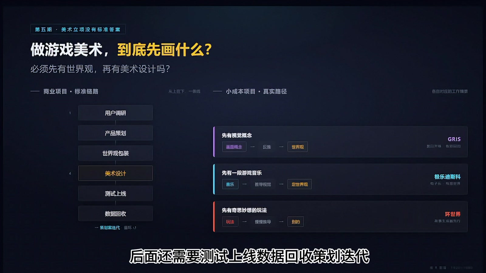
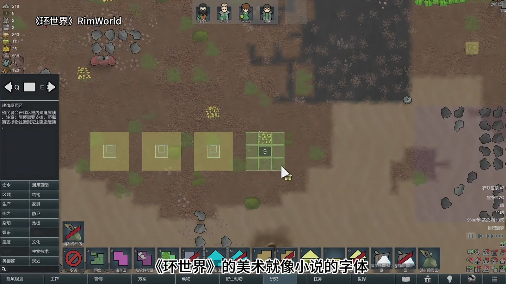
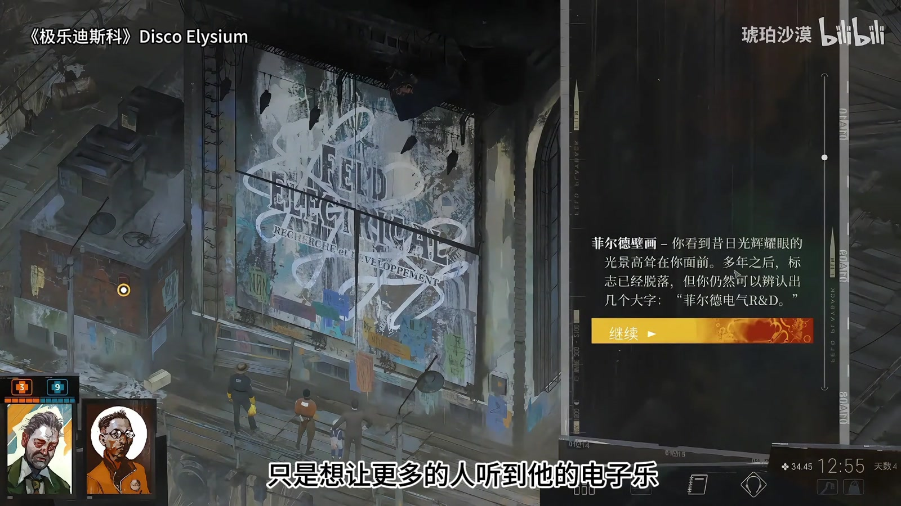
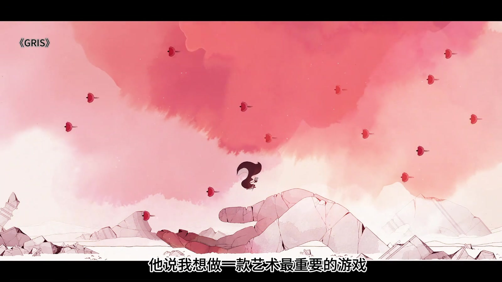
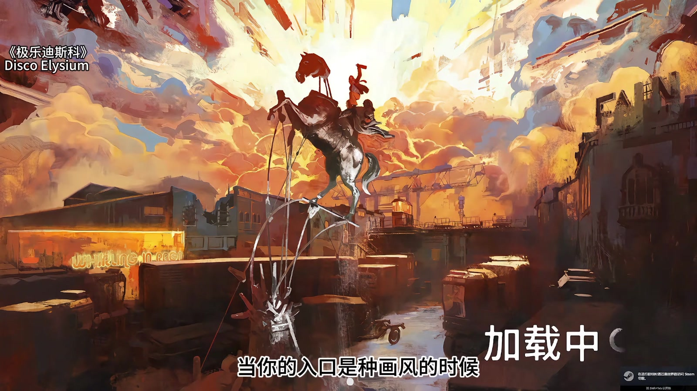
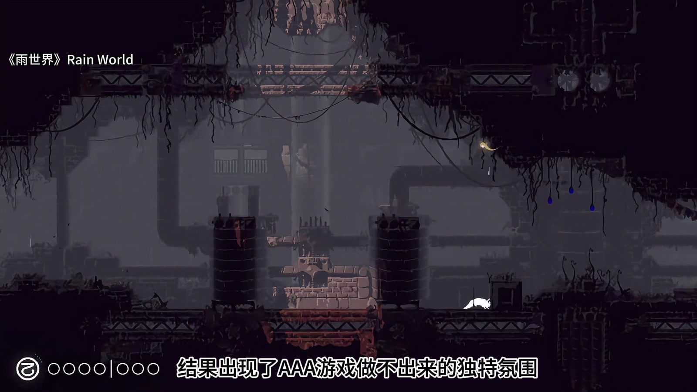
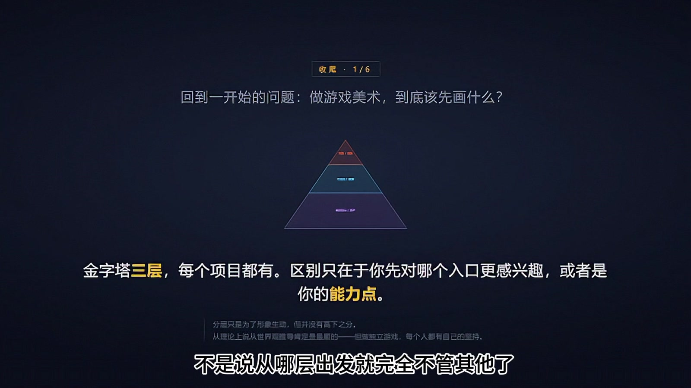
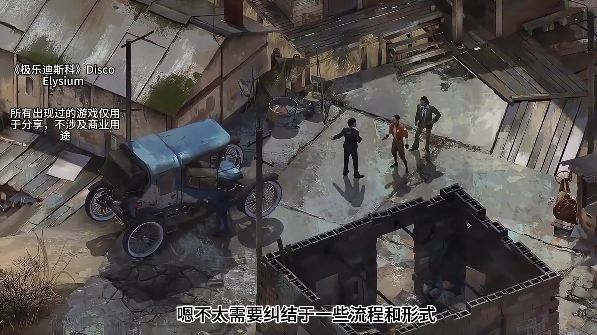
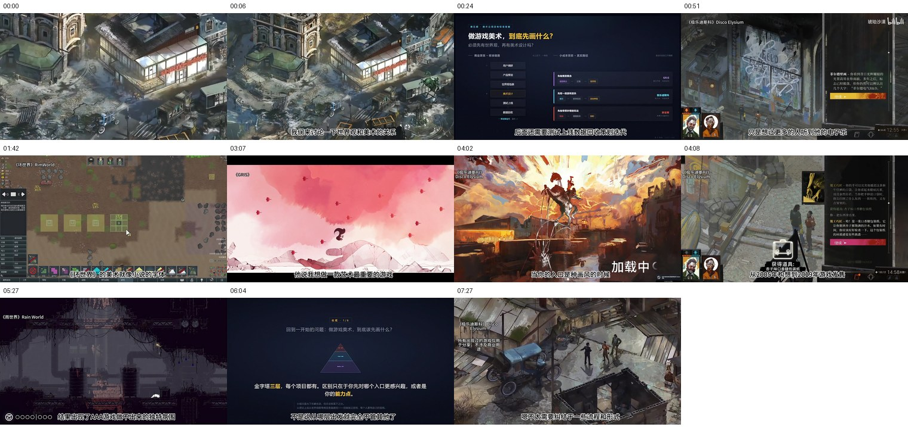

# AI 游戏美术立项：先有画风还是先有玩法？

> 作者 **野路子游戏车间（K 米）** ｜ 时长 **07:34** ｜ 抖音 ｜ 点赞 642 · 收藏 505
> 原视频：https://www.douyin.com/video/7692132863755537718

## 一句话概括

做游戏美术没有固定顺序，只有**三个入口**——**题材驱动**（先想清玩法要表达什么，美术像小说字体一样不抢戏）、**画风驱动**（先被一种画风打动，再反推它适合什么游戏）、**形象驱动**（先做出一个一眼读懂的角色/生物/物件，再长出世界观）；选哪层进场取决于你的**能力点和兴趣点**，而 AI 的价值是把任何一层都先低成本跑起来试错。

## 30 秒版要点

- **商业项目的标准链路**是一条直线：发行 → 用户调研 → 产品策划 → 世界观包装 → 美术设计 → 测试上线 → 数据回收 → 策划迭代。世界观在前、美术在后。
- **但这个链路对独立/小成本项目不成立**：GRIS 的起点是一个"黑白开场、色彩一点点回来"的画面概念；极乐迪斯科起源于"想让更多人听到我的电子乐"；环世界是先搭故事生成器的玩法系统。
- **入口一 · 题材驱动**：美术的任务是"不出错地把玩法表现好"。环世界主创原话——*美术要像小说的字体一样，看得清发生了什么、不丑、不被细节淹没就够了*，这是解决问题的方案，不是精心打造的美学。
- **入口二 · 画风驱动**：美术就是强项时走这条。GRIS 里**颜色就是机制和叙事**（灰阶开场，红绿蓝随流程解锁对应悲伤阶段）；《烟火》是"描摹图片上色"、到了《三伏》才明显有配色构图和构成技巧。
- **代价是周期**：极乐迪斯科 **2005 构想 → 2019 发售，跨度 14 年**；INSIDE 做了 **6 年**。AI 只能省体力活，**画风驱动最核心的美术设计省不掉**。
- **入口三 · 形象驱动**：先做一个一眼读懂的东西。雨世界的 Slugcat（蛞蝓猫）——先画了只"长猫"，观众喜欢，才反推世界观、写程序化动画，做出"3A 做不出来的氛围"。
- **金字塔没有高下**：顶层题材、中层画风、底层形象。它是**看别人作品的放大镜，不是约束自己的流程**。

## 分步拆解

### 1. 先把两条链路摆在一起（00:24）

这是全片的结构图，值得逐格看：

| 商业项目 · 标准链路（从上往下） | 小成本项目 · 真实路径 |
|---|---|
| 1 用户调研 | **先有视觉概念**：画面概念 → 反推 → 世界观（GRIS） |
| 2 产品策划 | **先有一段游戏音乐**：音乐 → 推导视觉 → 定世界观（极乐迪斯科） |
| 3 世界观包装 | **先有奇思妙想的玩法**：玩法 → 慢慢推导 → 别的（环世界） |
| 4 美术设计 | |
| 5 测试上线 | |
| 6 数据回收 → 策划迭代（循环） | |

左边那条线里，**美术设计排在第 4 位**，前面全是调研、策划、世界观。右边三种起点则完全不按这个顺序——它们各自从"最能打动创作者的那一件事"出发。

### 2. 入口一：玩法 / 题材驱动（01:42）

这条路的思考方式是**自上而下**：先确定"这个游戏要表达什么、玩家对什么玩法最感兴趣"，再让美术去服务它。

环世界的判断标准极其克制——*"只要美术看得清楚发生了什么、不丑、不被细节淹没就够了"*。作者特别点出：这是**解决问题的方案，而不是精心打造的美学**。

国产的同款思路是《中国式家长》：两个开发者认定"中国式亲子关系"这个题材能做游戏就开工了，画风夸张怀旧但**称不上精美**、UI 数值粗暴压迫感满满，发售第一天冲到 Steam 中国区第二。它赢在题材和玩法，不在画工。

### 3. 入口二：画风驱动（00:51 – 03:07）

这条路是**反过来推**的：你先被一种画风打动，手里有一套"怎么画才成立"的经验，再倒推它适合做什么游戏。

- **GRIS**：水彩插画家出身的主创，最初的念头不是玩法而是一个画面概念——黑白开场，色彩随流程一点点回来。玩法是后面补的，**一开始连死亡设定都没有**。
- **《烟火》→《三伏》**：月光蟑螂一个人自学编程和美术。《烟火》里的物品更像"拿图片描摹上色"的符号，提示玩家有这个东西但融不进环境；到《三伏》才有配色、构图和构成的技巧——**"这些是设计出来的结果"**。

### 4. 这条路的代价：周期失控（04:02）

| 项目 | 周期 |
|---|---|
| 极乐迪斯科 | 2005 构想 → 2019 发售，**跨度 14 年** |
| INSIDE | **6 年** |

作者的话很直白：**"画风驱动很爽，但你要做好为这个画风长期买单的准备。"**

### 5. AI 能缩短这个时间吗（04:24）

作者的答案是**部分能，但不是关键**：AI 可以辅助美术的体力活，但**画风驱动最核心的是美术设计**。以美术见长的游戏不一定要高超技巧，而是画面设计精巧——这需要大量美术经验，AI 替代不了。

### 6. 入口三：形象驱动（05:27）

这条路只要求一件事：**做出一个一眼就读懂、且独特的东西**——一个角色、一个生物、一个物件。

雨世界的 Slugcat（蛞蝓猫）就是这么来的：先画了只"长猫"，YouTube 观众给它起了名字、喜欢上了它，创作者才**反推世界观**、写整套程序化动画让每个生物对环境有反应。其中一位成员是学平面设计出身、此前没做过游戏，全程临场发挥，结果做出了"3A 游戏做不出来的独特氛围"。

所以作者说：**"如果你想换一个角色，这本身就是一种立项，而不是不务正业。"**

### 7. 金字塔：三层没有高下（06:04）

| 层级 | 驱动 | 起点 | 典型 |
|---|---|---|---|
| 顶 | 题材驱动 | 玩法 / 世界观 | 环世界、中国式家长 |
| 中 | 画风驱动 | 被某种画风打动 | GRIS、极乐迪斯科、烟火/三伏 |
| 底 | 形象驱动 | 一个角色或物件 | 雨世界（Slugcat） |

关键提醒：分层只是为了形象生动，**没有高下之分**。理论上从世界观往下推最顺，但真做起来，"最后每一层都需要反复考虑和修改"。

### 8. 金字塔是放大镜，不是流程（07:27）

- **它是用来看别人作品的放大镜**——看到一款游戏，能判断它是从哪层长出来的；
- **不是约束自己的流程**——小团队最大的优势恰恰是"没有流程包袱"：一个人脑子里的想法，想了就等于完成了全部对齐，**省掉整支团队的沟通成本**。

而 AI 已经把很多能力壁垒击穿了：帮你完善逻辑、评估策划案、**一天之内出几十套原画**快速验证风格。所以不必再纠结顺序——

> 先问自己最擅长什么、被什么打动，然后用最低成本从那一层进去。**做完比做对更重要。**

## 三个入口对照表

| | 题材驱动 | 画风驱动 | 形象驱动 |
|---|---|---|---|
| 你先有什么 | 玩法/题材的判断 | 一套画风经验 | 一个独特形象 |
| 思考方向 | 自上而下（先想清楚再落地） | 反向推导 | 从符号长成世界 |
| 美术的角色 | 不出错、别抢戏 | 就是主角 | 信息传达要有效 |
| 核心能力 | 认知视野、决策 | 设计原理、执行力 | 创意、独特性 |
| 主要风险 | 玩法不够吸引人 | **周期失控** | 形象撑不起内容 |
| 案例 | 环世界、中国式家长 | GRIS、极乐迪斯科 | 雨世界 |

## 关键帧总览

## 可以直接带走的三条经验

1. **别把商业流程当成唯一正确答案**：美术设计排第 4 位那条线，是给"有发行、有调研"的项目用的；独立项目从哪层进都行。
2. **每层都有明确的验收标准**：题材驱动看"美术有没有抢戏"，画风驱动看"颜色/笔触是否承担叙事"，形象驱动看"一眼能不能读懂"。用这套标准去审视自己的项目，比纠结顺序有用。
3. **AI 的正确用法是"快速试错那一层"**：一天几十套原画用来验证风格感受，而不是指望它替你完成美术设计。

---

完整口播文字稿（带时间点）见 `transcript.md`。
