# 为什么小丑牌的音乐停不下来 —— 7 拍少了一拍，所以永远「差一点落地」

> 作者 **Casoline** ｜ 时长 **01:16** ｜ 抖音 ｜ 赞 2.8w · 收藏 4663 · 评论 720 · 转发 6358
> 原视频：https://www.douyin.com/video/7702320718889856107
> 音乐：LouisF《Balatro Main Theme》｜**本片无口播，内容据屏上文字与拍号可视化整理**

## 一句话概括

《小丑牌》主题曲用的是 **7/4**，而且分组成 **2 + 3 + 2**——它比两小节 4/4 正好**少一拍**，
所以每一圈都会在你以为要落地的时候提前被推进下一圈；这种"永远差一点"的循环，正是游戏那句「再来一局」的听觉版本。

## 30 秒版要点

- 绝大多数流行歌是 **4 拍**一圈，身体习惯了这个周期；用 4 拍去数小丑牌，**你怎么数都会踩空**
- 小丑牌是 **7 拍**（7/4），并且不是平均分，而是 **2 拍 + 3 拍 + 2 拍**
- 7 = 2×4 − 1：**比两圈 4 拍少一拍**，所以循环总在差一拍的地方回头
- 把缺的那一拍补上，就变成规规矩矩的 4/4——**立刻不好听了**，因为"不落地"的感觉被抹平
- 再叠上**摇晃的音色**，7 拍的失衡 + 音色漂移 = 迷幻感，也是它停不下来的原因
- 作者明确标注：**LouisF 本人没解释过为什么用 7/4**，以上是个人解读

## 分步拆解

### 1. 先用 4 拍去数，你会一直踩空（00:06）

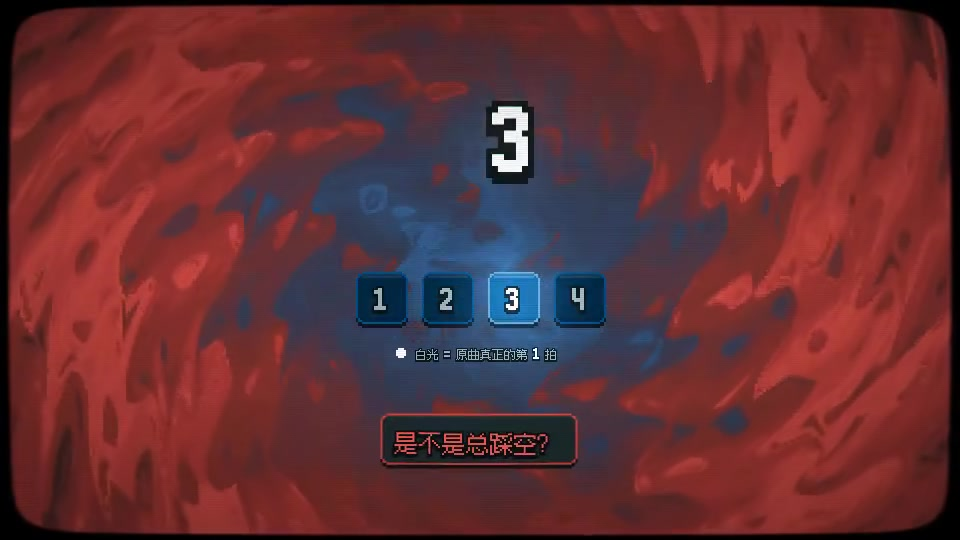

片子的入口是个陷阱：让你跟着 1、2、3、4 数。屏幕小字写得很清楚——
**「● 白光 = 原曲真正的第 1 拍」**。也就是说你数的这套 4 拍是"外来尺子"，
原曲自己走的是另一套周期。

数着数着就会发现对不上，于是打出那句：**「是不是总踩空？」**。这不是你数错了，
是尺子本来就不合。绝大多数流行歌都是 4 拍一圈（00:16），身体早就被训练成 4 拍一跳，
遇到不合拍的曲子，第一反应不是"这曲子换了拍号"，而是"我是不是漏了一拍"。

### 2. 小丑牌是 7 拍，而且是 2 + 3 + 2（00:21）

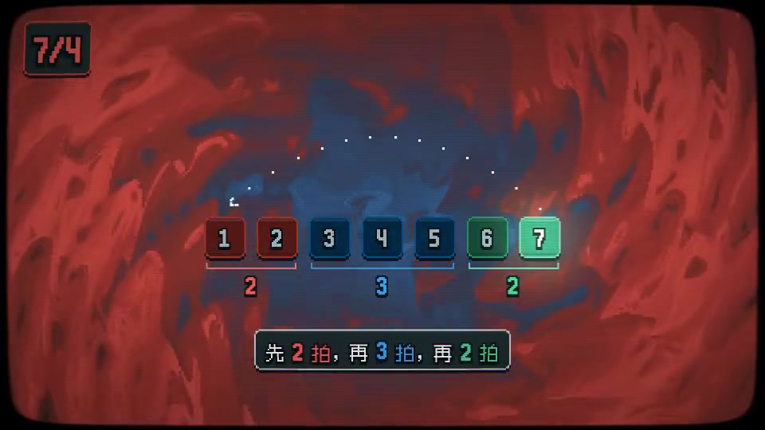

换成 7 个格子就顺了。但关键不只是"7 拍"，而是它**怎么分组**：

| 分组 | 格子 | 拍数 |
|---|---|---|
| 红 | 1、2 | 2 |
| 蓝 | 3、4、5 | 3 |
| 绿 | 6、7 | 2 |

**2 + 3 + 2** 而不是常见的 3 + 4 或 4 + 3。这一步很重要：同样 7 拍，
分组不同，重音的落点完全不同，2+3+2 会让中段那个 3 拍显得"拖了一下"，
再回到 2 拍又"赶了一下"，天然带一种跛脚的摇摆感。

### 3. 7 拍 = 两圈 4 拍少一拍（00:26）

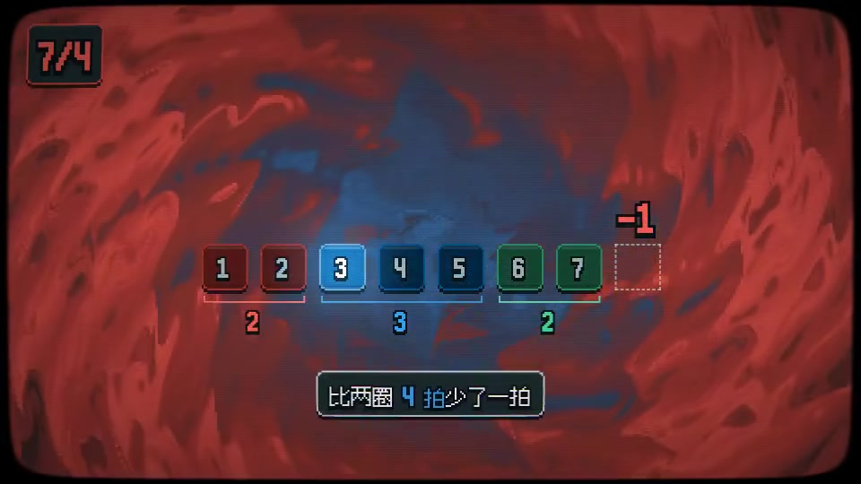

这是整支片子的核心一步：把 7 拍和"两小节 4/4"对起来看。
两小节 4/4 是 8 拍，**7 拍正好少一个**。屏幕上给虚线的第 8 格打了个 **−1**，
字幕是「比两圈 4 拍少了一拍」。

这个视角一下就把问题说透了——不是"多了一拍"，是**少了一拍**。
人的听觉预期是按 8 拍建的，曲子只给 7 拍就回头，于是：

> **「所以总会提前回到起点」**（00:31）

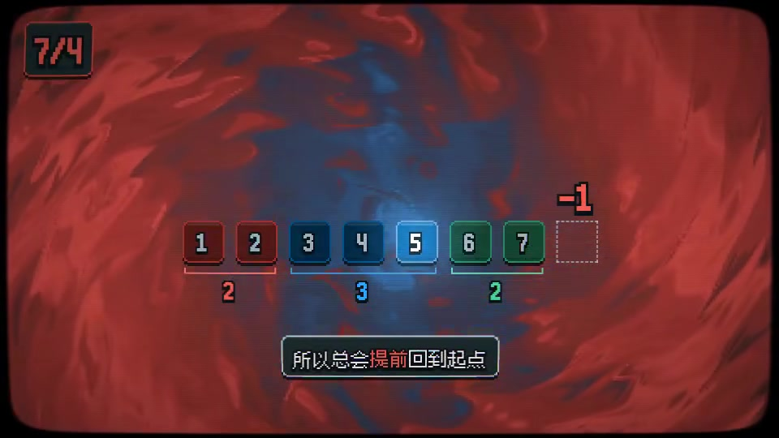

### 4. 把那一拍补上，它就"死"了（00:36）

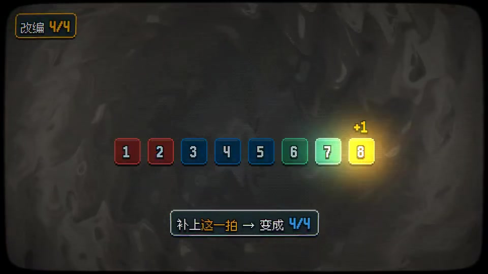

作者做了个反证：**补上这一拍 → 变成 4/4**。分组线一消失，8 个格子整整齐齐，
音乐立刻变得方正、可预测。结论是反着的——**规整不是优点**。
7/4 那个"缺一格"才是它气质的来源，补上了反而没味道。

### 5. 再听原版：接缝是听得出来的（00:44 → 00:52）

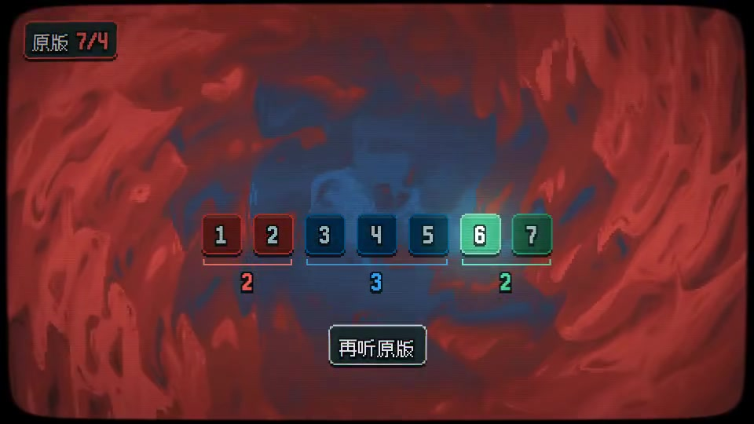

同一条音乐，上下两条轨道并排：上面按 **4/4** 画，下面按 **7/4** 画。
两排点在同一条竖线上的错位，就是两把尺子的偏差在累积。

> **「循环的接缝也听得出来」**（00:52）

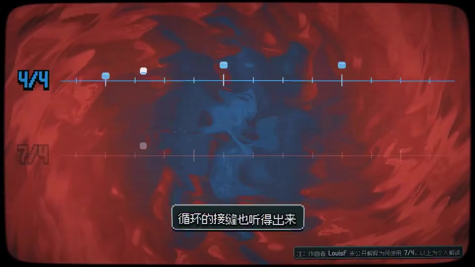

一般 loop 的接缝是藏起来的，7/4 反而藏不住——每一圈都会在同一处"露馅"。

### 6. 「快落地时被推进下一圈」（00:56）

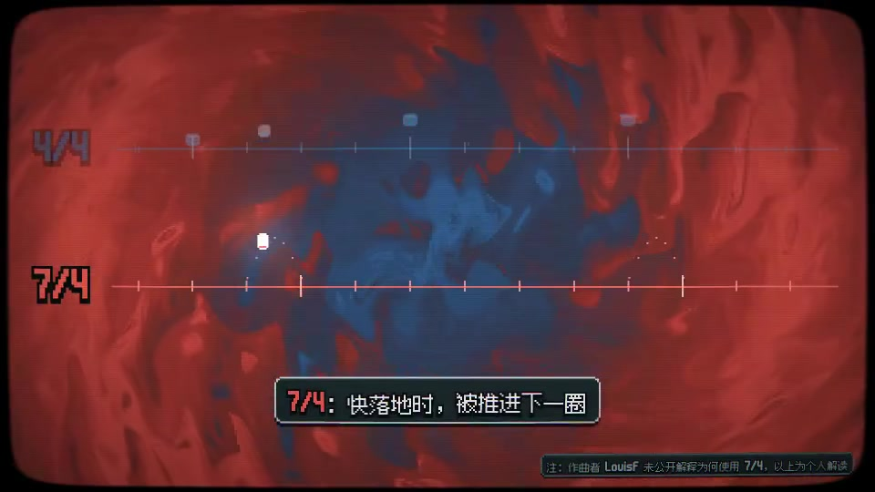

这句是整片最好的比喻。听感上你会觉得旋律**正要落下来**，
但第 7 拍走完，它不等你站稳就把你推进下一圈。

> **「大脑刚预测好下一拍，又被绊了一下」**（01:00）

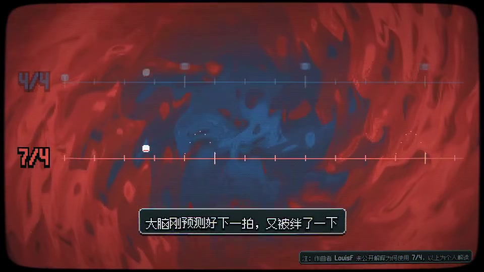

这就解释了"停不下来"：不是它不给你结束，是它**每次都差一点给你结束**。
大脑的预测机制被反复调到"马上要解决"的状态，又反复不解决，于是注意力一直被吊着。

### 7. 摇晃的音色，把失衡变成迷幻（01:03 → 01:06）

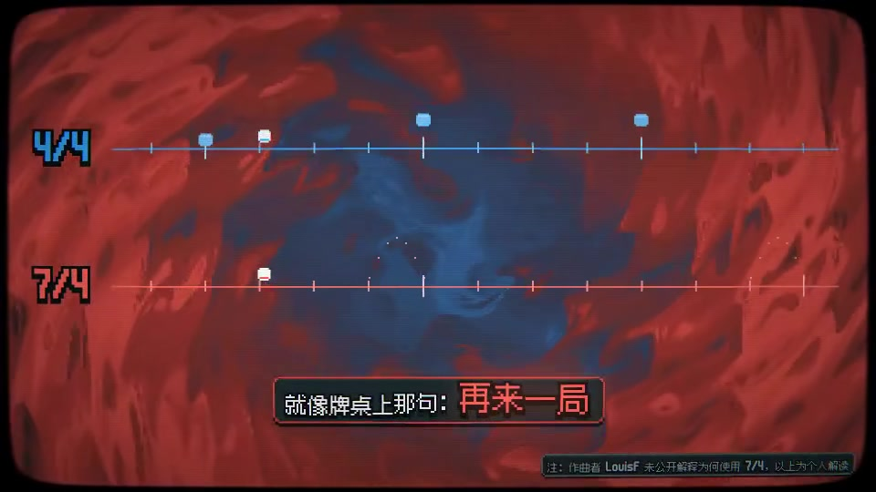

节拍层面讲完，作者补上音色这一层：**「再叠上摇晃的音色，迷幻感就来了」**（01:06）。
音高或相位的轻微漂移，叠在本来就不稳的 7 拍上，两层"失稳"叠乘，
听感从"好奇"变成"晕"。

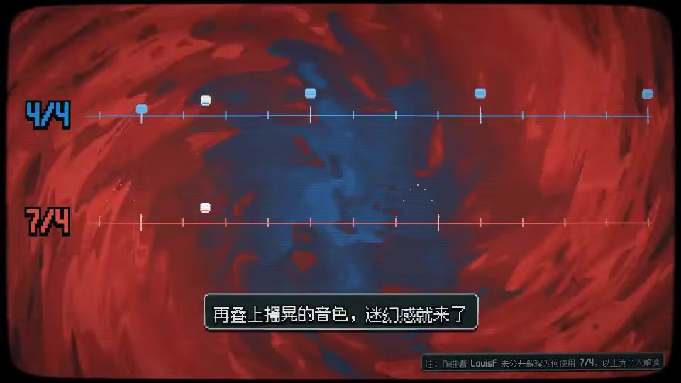

最后一句才把音乐和游戏接起来——**「就像牌桌上那句：再来一局」**。
Roguelike 的循环机制和小丑牌的 7 拍循环，在结构上是同一个东西：
**永远在"差一点就成"的位置重新开始。**

### 8. 结尾：它自己也在数（01:10）

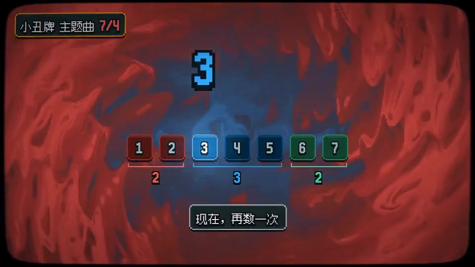

片子没有给结论，而是回到开头那句「现在，再数一次」，继续数 1、2、3……
在 01:14 淡出、上字幕。**用形式本身收尾**：你等不到它落地，只能再来一遍。

## 可抄参数表

| 项 | 内容 |
|---|---|
| 曲目 | LouisF《Balatro Main Theme》（小丑牌主题曲） |
| 拍号 | **7/4** |
| 分组 | **2 + 3 + 2** |
| 与 4/4 的关系 | 7 = 2×4 − **1**（少一拍） |
| 对照实验 | 补 1 拍 → 变成规整 4/4，失衡感消失 |
| 二次叠加 | 摇晃/漂移的音色 → 迷幻感 |
| 视觉辅助 | 白光点 = 原曲真正第 1 拍；上下双轨 = 4/4 与 7/4 两把尺子 |
| 片尾署名 | 音乐 LouisF｜字体 m6x11 by Daniel Linssen / Ark Pixel Font｜非商业科普 |

## 关键帧总览

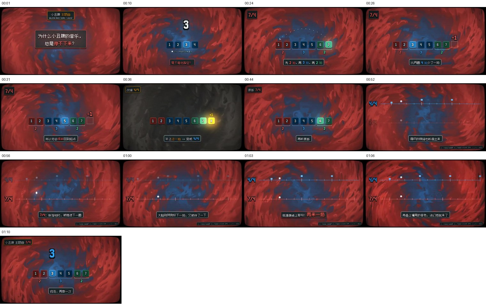

## 可以直接带走的三条经验

1. **"少一拍"比"多一拍"更有说服力**。7/4 听感上的不安定，用「比两小节 4/4 少一拍」解释，比说「7 是质数」有用得多——它给了一个**参照物**，而不是一个数字。
2. **分组决定气质，拍号只决定长度**。同样 7 拍，2+3+2 和 3+4 是两种曲子；分析节奏型时先问怎么分，别停在"几几拍"。
3. **要证明一个设计有效，就把它改坏**。作者补上一拍变 4/4，让"规整"当场变得平庸——这个反证比十句"7/4 很特别"都有力。

> ⚠️ 作者自己在片中标注：**LouisF 未公开解释为何使用 7/4**，2+3+2 的分组与「少一拍」都是本视频的解读，
> 不是作曲者的说法。引用时请保留这一条。
