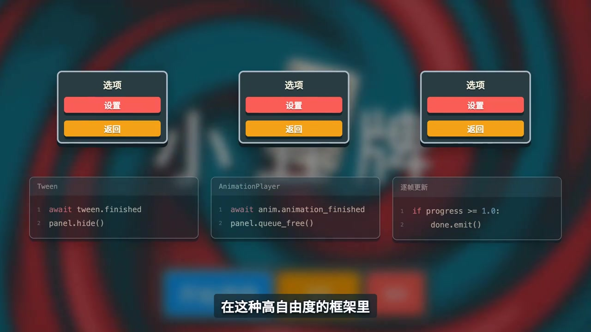
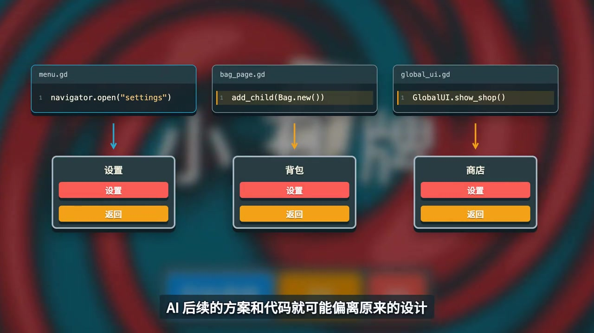
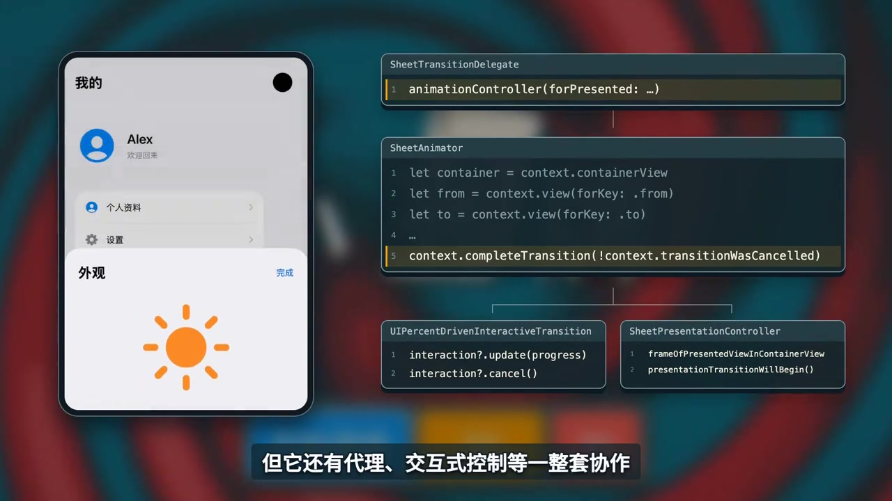
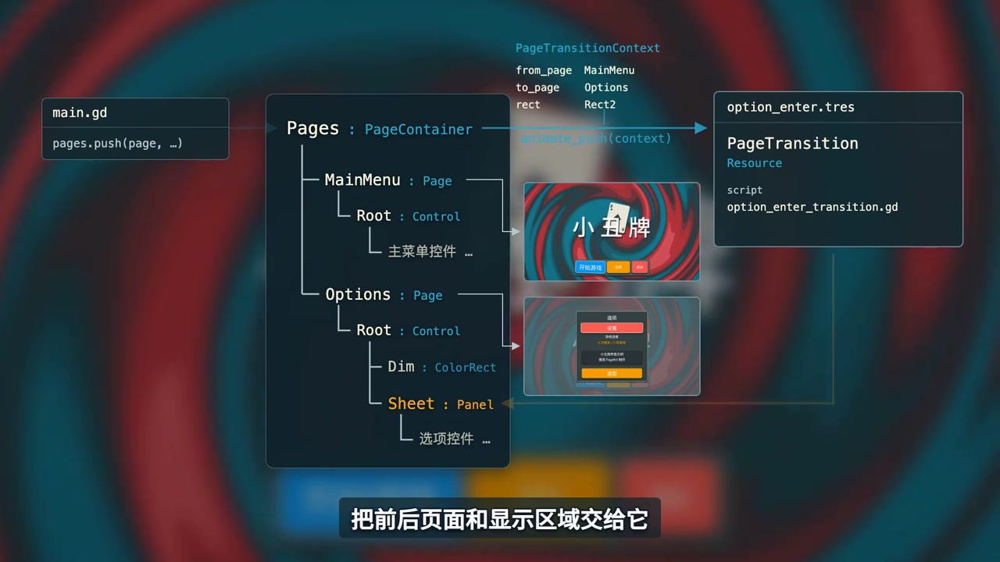
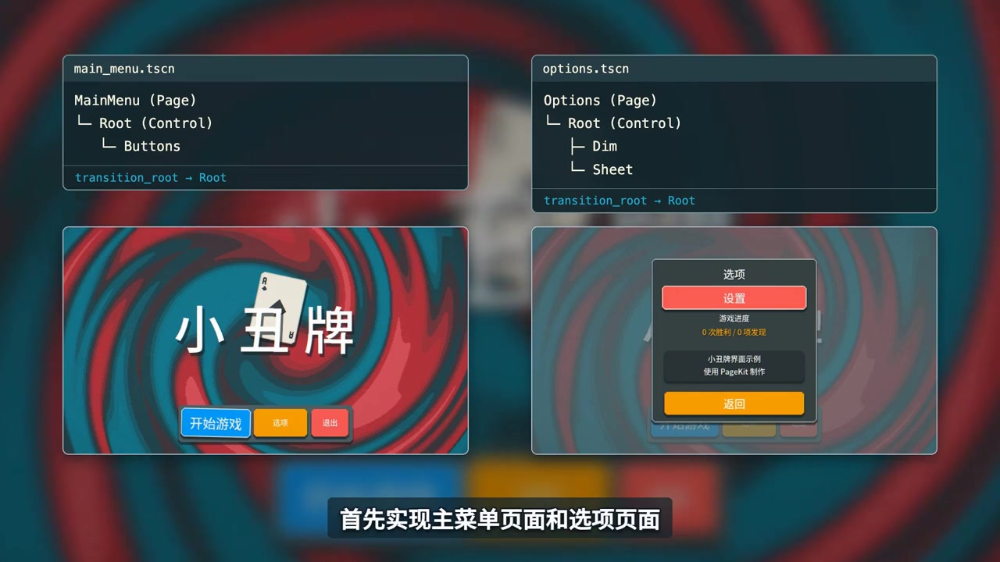
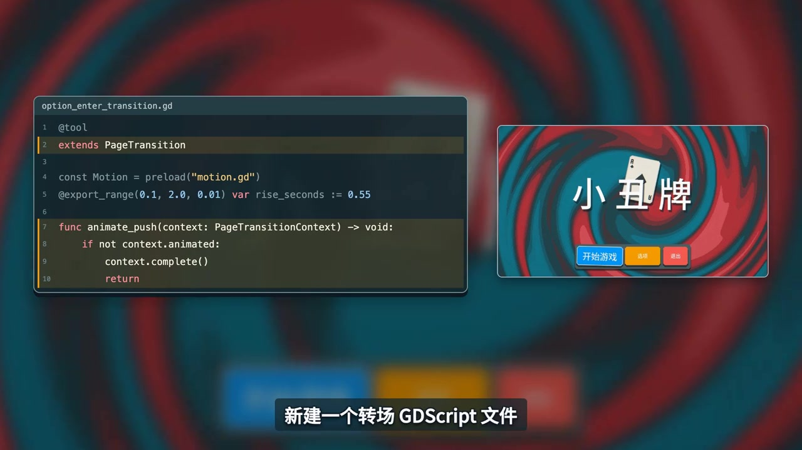
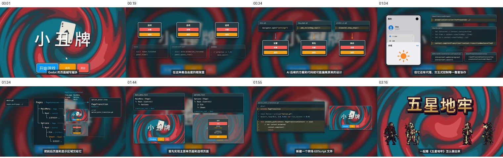

# 今天继续驯服 AI —— 用 PageKit 给 Godot 的页面导航上规矩

> 作者 **babyunko** ｜ 时长 **03:18** ｜ 抖音 ｜ 点赞 33 · 收藏 27
> 原视频：https://www.douyin.com/video/7703573494676899008

## 一句话概括

Godot 自由度太高，**同一个面板入场能用 Tween、AnimationPlayer、逐帧改坐标三种写法**，AI 于是给每个页面各写一套，功能越多越散；作者按 iOS UIKit 的转场协议做了一套极简框架 **PageKit**——`Page`（内容+状态）/ `PageContainer`（导航与生命周期）/ `PageTransition`（动画，单独一个 gdscript 文件）/ 转场上下文 + `complete()` 回调，**把动画从"随手写"收进"必须继承一个类"**，代价是每个效果仍要手写代码。

## 30 秒版要点

- **问题不是 AI 不会写，而是它有太多正确写法**：画面看着一样，调用和收尾却各写一套；项目小的时候不显眼，功能一多就开始偏离原设计。
- **解法是"带脚镣跳舞"**：用**少量设计和规则**约束实现，而不是每次自由发挥。
- **PageKit 借鉴 UIKit 的转场协议**：UIKit 通过 context 把 from/to/container 交给转场对象，执行完明确报告完成。
- **做减法**：UIKit 还有代理、交互式控制等一整套协作，这里**只保留三件事**——动画需要的信息、执行入口、完成通知。
- **四个角色**：`Page` 存内容和状态，`PageContainer` 管导航/返回/历史/准备与清理，`PageTransition` 是资源、只改页面内的视觉节点，上下文负责把前后页面和显示区域递进去。
- **结束必须有回调**：Tween 结束 → 位置归位 → 调 `complete()` → 容器才完成这次导航。**动画怎么写随意，收尾规则统一**。
- **代价很诚实**：不同效果仍要写不少代码（作者自认是被 Xcode 可视化编辑"折腾"出来的习惯），好在转场代码集中在独立文件里，可以直接让 AI 写。

## 分步拆解

### 1. 起因：自由度太高（00:19）



作者先摆出问题：Godot 里"选项面板收起"至少三条路，连**收尾代码都不一样**：

| 写法 | 收尾代码 |
|---|---|
| `Tween` | `await tween.finished` → `panel.hide()` |
| `AnimationPlayer` | `await anim.animation_finished` → `panel.queue_free()` |
| 逐帧更新 | `if progress >= 1.0: done.emit()` |

对人来说这是自由，**对 AI 来说这是"每次都从零选方案"**。同一个表现被三种方法实现，画面看不出差别，但：

- 调用方式不同（谁来触发：`navigator.open()` / `add_child()` / `GlobalUI.show_shop()`）
- 收尾逻辑不同（`hide()` / `queue_free()` / 自定义信号）

项目小的时候差异不显眼，等页面多起来就是一堆平行实现。

### 2. 越加越多，就越写越散（00:34）



这三个文件干的是同一件事——打开"设置"：

| 文件 | 代码 |
|---|---|
| `menu.gd` | `navigator.open("settings")` |
| `bag_page.gd` | `add_child(Bag.new())` |
| `global_ui.gd` | `GlobalUI.show_shop()` |

作者的判断更进一步：真正的风险不是"写得丑"，而是**偏离原设计**。不持续约束 AI，它会为每个新页面重新发明一套入场动画，同类功能逐渐分叉。

于是有了那句核心比喻——

> 开发和游戏设计一样，**带着脚镣跳舞**反而更容易做好。

### 3. 参考对象：UIKit 的转场协议（01:04）



作为 iOS 程序员，作者直接抄了自己熟悉的范式：UIKit 的转场里，系统通过**上下文（context）** 把「来向页面 / 去向页面 / 容器视图」交给转场对象，转场对象负责跑动画，跑完**明确报告完成**，系统才继续。

但 UIKit 那套还捆着代理、交互式转场（手势拖拽）等协作机制。作者明确做了减法：**"没有把这些高级概念整套搬进来，只保留动画需要的信息、执行入口和完成通知。"**

这是整段最值得学的取舍：**照抄范式，不照抄复杂度。**

### 4. 四个角色（01:34）



| 角色 | 职责 |
|---|---|
| `Page` | 一个界面。页面内容 + 自己的状态都在这里 |
| `PageContainer` | 容器。负责导航、返回、历史，并调用页面的**准备与清理** |
| `PageTransition` | 转场**资源**。只修改页面内部的视觉节点，不碰布局 |
| 转场上下文 | 把「前一个页面 / 后一个页面 / 显示区域」递给转场对象 |

一条关键的分工线：**页面的根节点归容器布局，转场只许动页面里面的视觉节点**。这样动画再花哨也不会破坏布局规则。

### 5. 最小可用：先硬切（01:44）



作者刻意先做一个**没有任何动画**的版本：两个页面 + 一次导航，能打开选项、能返回主菜单。此时切换是硬切。

这个顺序很重要——先把**导航**跑通，再叠加**转场**，两者互不干扰。

### 6. 转场写在单独的文件里（01:55）



写一个入场动画的完整流程：

1. 新建 `PageTransition.gd`，**继承转场基类**
2. 拿到选项面板，**记下它原来的位置**
3. 把面板移到容器下方（画面外）
4. 创建 `Tween` 把位置更新回来
5. Tween 结束 → **位置归位** → 调 `complete()`
6. 用这个脚本创建转场资源，传给导航调用

结果：再次打开选项，面板从下方滑入。而**这套"接入 → 执行 → complete"的骨架是固定的**，以后所有转场都只填中间的动画部分。

作者举了更复杂的例子：翻牌转场——遮住画面、完全遮挡后换页、再让纸牌消散。效果可以很复杂，**但接入和结束的规则完全不变**。

### 7. 收益与代价（02:31 – 03:18）


**收益**（也是这次"驯服 AI"的真正落点）：

- 动画编排逻辑集中在独立文件，好查、好改
- 降低心智负担，减少反复删改
- 后续改需求、更新代码更容易控制
- 接上一期的「**教程驱动开发**」（先写教程、再按教程实现），这次补上了**编程流程的控制**

**代价**：

- 不同效果仍要写不少代码
- 作者承认自己习惯用代码编排动画，是"被 Xcode 可视化编辑折腾久了"养成的路径依赖
- 但正因为**转场代码集中在专门的 gdscript 文件里**，这部分正好可以交给 AI 写

## 结构速查

```
PageKit
├── Page                内容 + 状态
├── PageContainer       导航 / 返回 / 历史 / 页面准备与清理
├── PageTransition      转场资源（只改页面内视觉节点）
└── TransitionContext   前后页面 + 显示区域

导航调用 → Container 建上下文 → Transition 跑动画 → complete() → Container 收尾
```

## 关键帧总览



## 可以直接带走的三条经验

1. **给 AI 的自由度就是给自己埋的债**：与其事后统一写法，不如一开始就规定"入场动画必须继承 PageTransition"，让错误写法在结构上不可能出现。
2. **抄范式、砍复杂度**：UIKit 的上下文 + 完成回调是精华，代理和交互式控制是负担；只搬前者。给框架做减法，比给自己加规则更有效。
3. **先跑通骨架再加表现**：导航先硬切能跑，转场再逐个加——这条对任何"AI 协作写代码"的项目都适用。

---

完整口播文字稿（带时间点）见 `transcript.md`。
