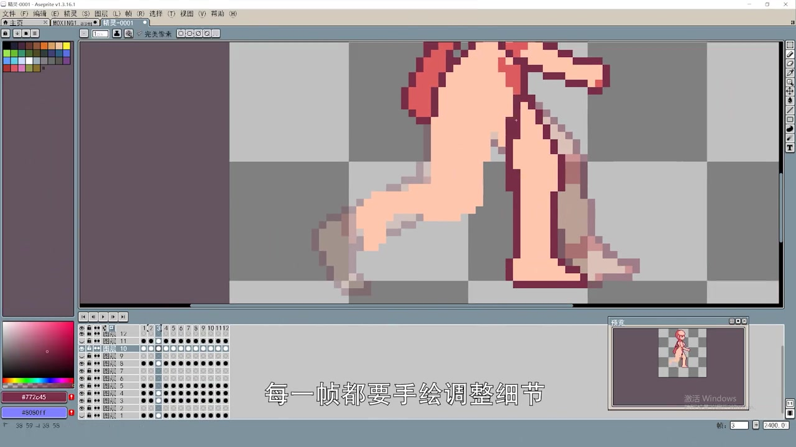
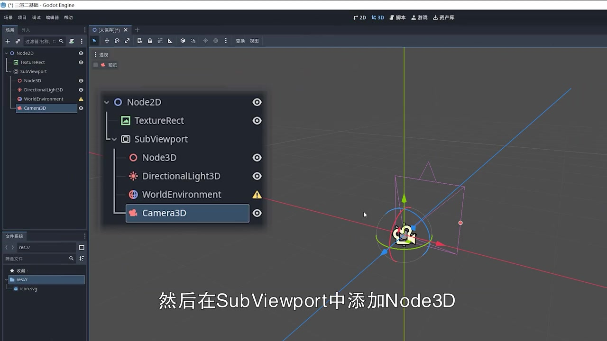
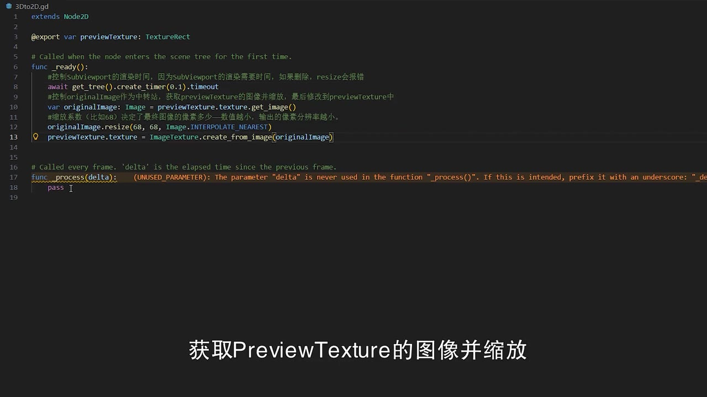
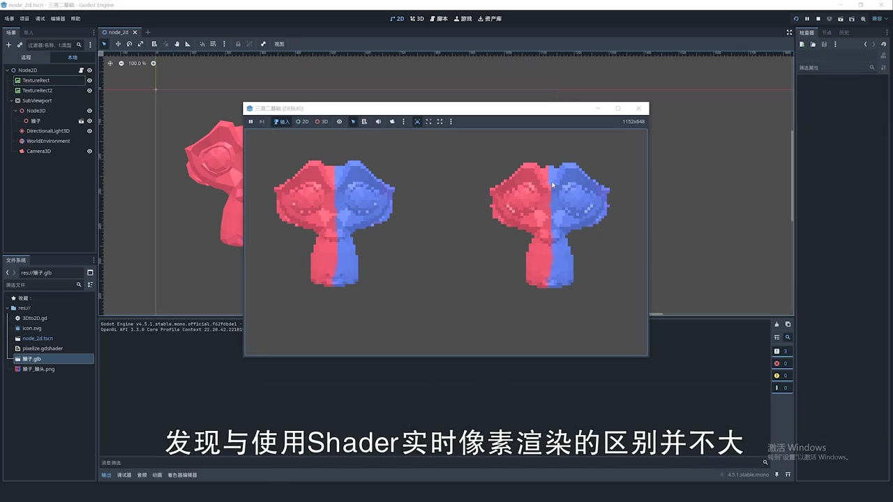
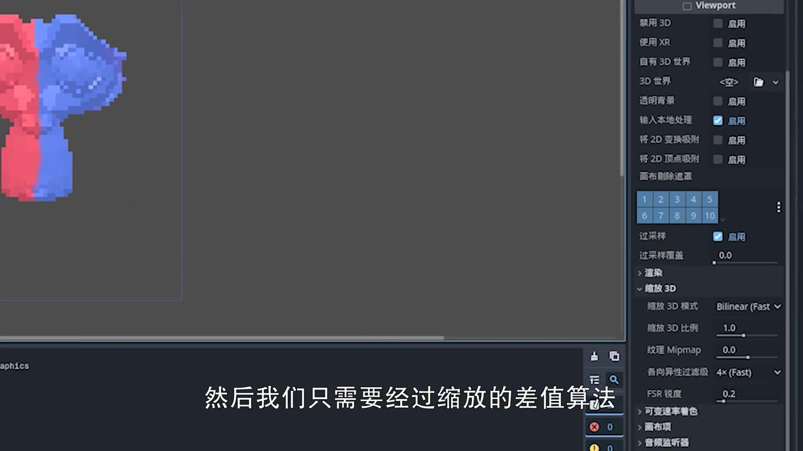
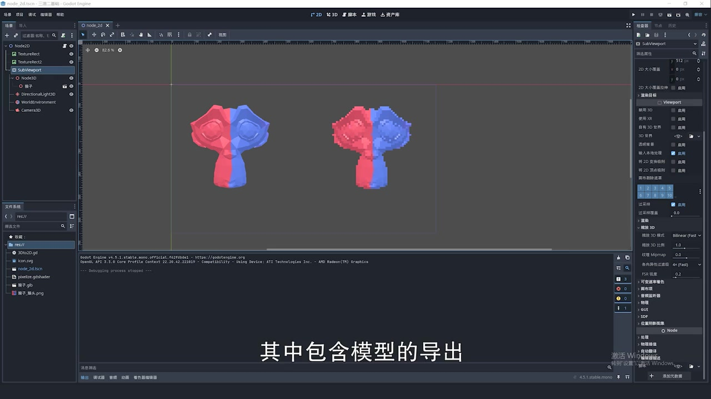
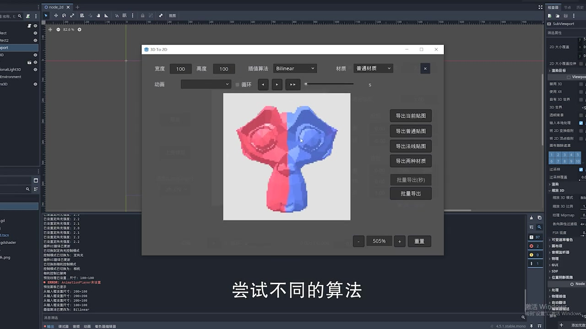
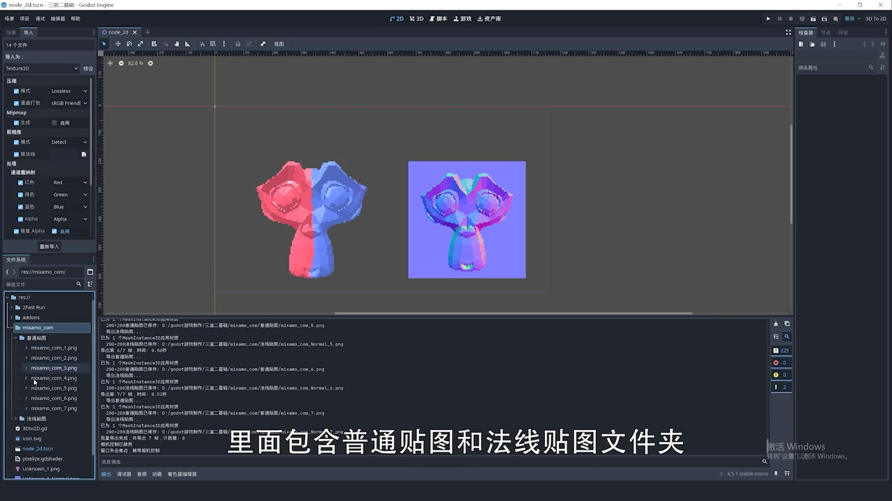
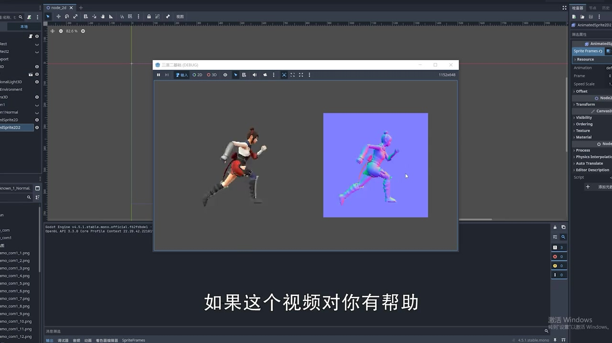
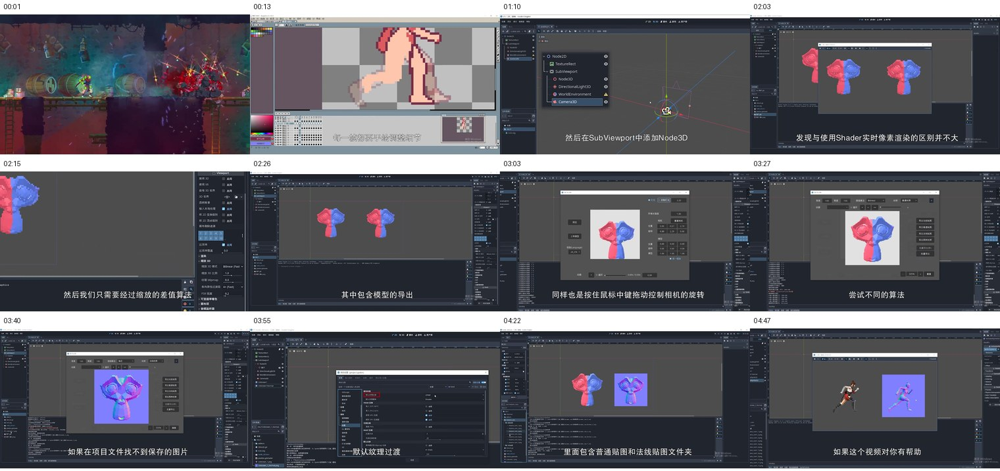

# 在 Godot 里做"死亡细胞"风格的像素三渲二

> 作者 **游画大叔** ｜ 时长 **04:50** ｜ 抖音 ｜ 点赞 90 · 收藏 93
> 原视频：https://www.douyin.com/video/7629651285154762019

## 一句话概括

用 **3D 模型 + SubViewport + 一次 nearest 缩放**把 3D 动作渲成 2D 像素图，再**按固定间隔批量抽帧**，就得到像素动画——本质是"把《死亡细胞》的三渲二流水线在 Godot 里最小复刻"，核心只有三步：**SubViewport 过滤设 nearest → 取出 ViewportTexture 的 Image 缩到几十像素 → 导出**。

## 30 秒版要点

- **动机**：非美术出身画像素动画，每帧都要手绘调细节，太慢；参考 3D 模型的动作更省力。
- **《死亡细胞》的思路**：3D 模型渲染成 2D 像素图，**既有流畅动作又保留像素质感**；只要对渲出来的像素动作**抽帧**，就是像素动画。
- **最小架构**：`TextureRect`（显示）+ `SubViewport`（渲染容器），`TextureRect.texture = ViewportTexture` 指过去。
- **两处 nearest 是灵魂**：SubViewport 的**纹理过滤 = nearest**（保硬边缘）；后面 `Image.resize` 也用 `INTERPOLATE_NEAREST`。
- **必须等 0.1 秒**：`await get_tree().create_timer(0.1).timeout`，否则 SubViewport 还没渲完，`resize` 会报错。
- **缩放数值 = 输出分辨率**：`originalImage.resize(68, 68, ...)` 里的 68 是目标像素边长，**越小越"像素"**。
- **效果对比**：这套"缩放插值法"和他另外做的 Shader 实时像素化版本**差别不大**。
- **插件把流程工程化了**：上传模型 → 调灯/相机 → 调分辨率 → 批量导出（如每 0.1 秒截一张）→ 得到普通贴图 + 法线贴图 → 拖进 PS / Aseprite 精修。

## 分步拆解

### 1. 为什么要做这件事（00:13）



作者的前提很实在：**画像素动画的成本在"帧"上**，不是画不好看，而是画不完。而参考 3D 模型的动作已经是很常见的做法——那干脆让 3D 直接产出像素帧。

《死亡细胞》的三渲二给了答案：3D 渲染成 2D 像素，**再抽帧**。

### 2. 最小场景：TextureRect + SubViewport（01:10）



节点结构：

```text
根节点 (Node2D, 挂脚本)
├── TextureRect            ← texture = ViewportTexture（指向下面的 SubViewport）
└── SubViewport            ← 纹理过滤模式 = nearest（关键）
    ├── Node3D             ← 放你的 3D 模型
    ├── DirectionalLight3D
    ├── WorldEnvironment   ← 环境光来源改 Color，设纯白，避免色偏
    └── Camera3D
```

两个容易漏的点：

1. **SubViewport 的纹理过滤必须是 `nearest`**，否则边缘会被插值糊成半透明灰边，像素感全没了。
2. **WorldEnvironment 的环境光来源改成 `Color` + 白色**，避免引擎默认环境色给画面带来无法控制的色偏。

### 3. 核心脚本：取图 → 缩放 → 写回（01:40）



```gdscript
extends Node2D

@export var previewTexture: TextureRect

func _ready():
    # 控制 SubViewport 的渲染时间——渲染需要时间，不等的话 resize 会报错
    await get_tree().create_timer(0.1).timeout
    # 用 originalImage 作中转站：取 previewTexture 的图像并缩放，再写回
    var originalImage: Image = previewTexture.texture.get_image()
    # 缩放系数（比如 68）决定最终图像的像素多少：数值越小，输出的像素分辨率越小
    originalImage.resize(68, 68, Image.INTERPOLATE_NEAREST)
    previewTexture.texture = ImageTexture.create_from_image(originalImage)
```

三行就是全部原理：

| 步骤 | 代码 | 作用 |
|---|---|---|
| 等待 | `await get_tree().create_timer(0.1).timeout` | 等 SubViewport 渲染完，否则 `get_image()` 拿到空图 / resize 报错 |
| 取图 | `previewTexture.texture.get_image()` | 从 ViewportTexture 拿到当前帧的像素 |
| 缩放 | `resize(68, 68, INTERPOLATE_NEAREST)` | **这一步决定"像素多大"**；nearest 不做插值，保留硬边 |
| 写回 | `ImageTexture.create_from_image(...)` | 换成缩小后的纹理显示 |

> **68 不是倍率，是目标边长**：`resize(68, 68)` = 输出 68×68 像素。想更"糊"更像素化就调小，想保留细节就调大（作者注释里写的就是"数值越小，输出的像素分辨率越小"）。

### 4. 和 Shader 方案对比（02:03）



作者另外写了一个用 Shader 实时做像素化的版本，两者并排跑：

> **"发现与使用 Shader 实时像素渲染的区别并不大。"**

结论：如果只是要出图（离线做素材），**Image 缩放这条路更简单**，不用写 shader；实时预览才需要 shader。



完整原理链：

```
Camera3D 渲染 3D → SubViewport 以低分辨率渲染 → ViewportTexture
   → get_image() 取出位图 → resize(nearest) 再次降采样
   → ImageTexture 写回 TextureRect → 导出即为 2D 像素图
```

### 5. 插件：把流程做成工具（02:26）



他把上面这套手工流程封装成编辑器插件，功能是"模型摆放 + 图片预览 + 动画导出"。

**安装**：把插件拖进项目 → `项目 → 项目设置 → 插件` → 启用 → 工具栏出现插件按钮 → 点开弹窗。

**操作要点**：

| 操作 | 做法 |
|---|---|
| 上传模型 | 点"上传模型"，选已导入项目的模型 |
| 只看到轮廓 | 先**开启灯光**并调强度 |
| 转灯光 | 点"控制灯光"，**按住鼠标中键拖动** |
| 转相机 | **中键拖动**旋转；**右键拖动**平移；"重置相机"回初始 |
| 调模型 | 右侧输入数字改位置 / 旋转 / 缩放 |
| 定分辨率 | 点"预览"后调宽度、高度，找想要的像素分辨率 |
| 换算法 | "插值算法"可切换——**其他算法边缘会有过渡**，不如 nearest 干脆 |
| 材质 | 普通 / 法线，导出会各生成一张贴图 |



### 6. 动画批量导出（04:13）



流程：换一个带动画的模型 → 调好相机与分辨率 → 设**批量导出秒数**（作者设 0.1 秒，即每 0.1 秒截一张）→ 批量导出到项目内 → 生成一个文件夹，内含**普通贴图 + 法线贴图**两套序列帧。

之后就是常规美术流程：**拖进 PS 或 Aseprite 精修**（去杂点、修轮廓、统一色板）。



### 7. 三个必踩的坑（踩过的人写的）

| 现象 | 原因 | 解决 |
|---|---|---|
| `resize` 报错 / 拿到空图 | SubViewport 还没渲染完 | `await ...create_timer(0.1).timeout` |
| 出图像素发虚、边缘发灰 | 纹理过滤用了线性插值 | SubViewport 过滤 = `nearest`；`resize` 用 `INTERPOLATE_NEAREST` |
| **导出后在项目里还是模糊** | 项目默认纹理过滤是线性的 | `项目 → 项目设置 → 渲染 → 纹理 → 默认纹理过滤 = nearest` |
| 项目文件里找不到导出的图片 | Godot 导入太快没识别 | 右键"重新导入"，或重启编辑器 |
| 模型只有轮廓、没有明暗 | 没开灯光 | 开启灯光并调强度 |

## 节点与参数速查

| 项 | 值 |
|---|---|
| 显示节点 | `TextureRect`，texture = `ViewportTexture`（指向 SubViewport） |
| 渲染容器 | `SubViewport`，**纹理过滤 = nearest** |
| 环境光 | `WorldEnvironment` → 环境光来源 `Color`，纯白 |
| 等待 | `await get_tree().create_timer(0.1).timeout` |
| 输出分辨率 | `originalImage.resize(68, 68, Image.INTERPOLATE_NEAREST)` |
| 项目设置 | 渲染 → 纹理 → 默认纹理过滤 = `nearest` |
| 批量导出间隔 | 0.1 秒（可按动作速度调） |

## 关键帧总览



## 可以直接带走的三条经验

1. **"三渲二"落地只要一次 nearest 降采样**：SubViewport 渲低分辨率 + `Image.resize(nearest)`，不需要写 shader，就能拿到干净的像素帧。
2. **像素感的两条命门都在过滤模式**：SubViewport 一处、项目设置一处、`resize` 一处——任一处用了线性插值，边缘就会发灰发虚。
3. **抽帧间隔就是动作的"帧率预算"**：0.1 秒/帧 ≈ 10fps 的像素动画，比手绘省一个数量级；导出后在 Aseprite 里精简关键帧，还能再砍一半。

---

完整口播文字稿（带时间点）见 `transcript.md`。
