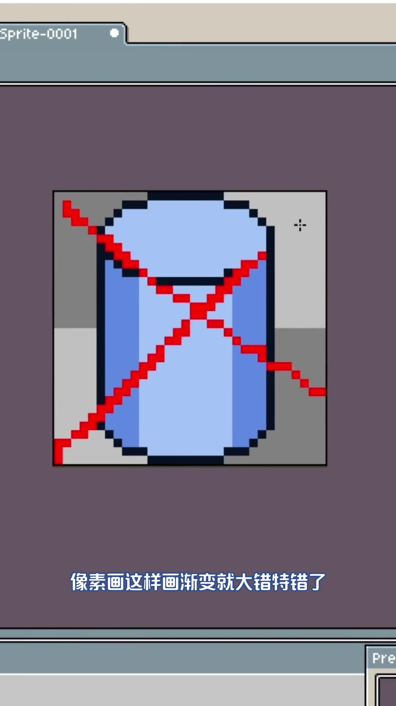
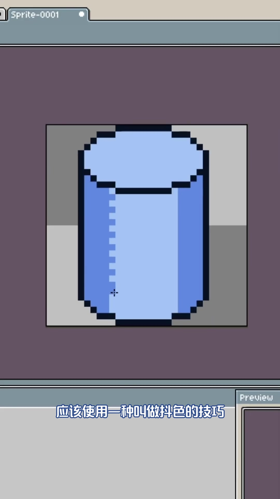
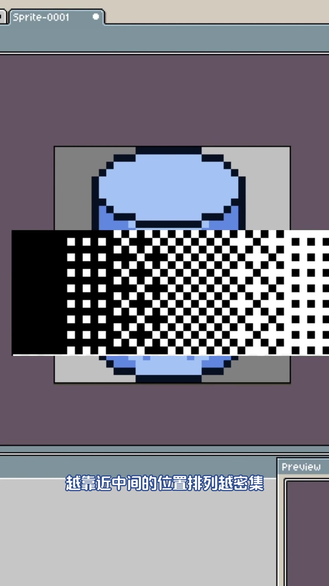
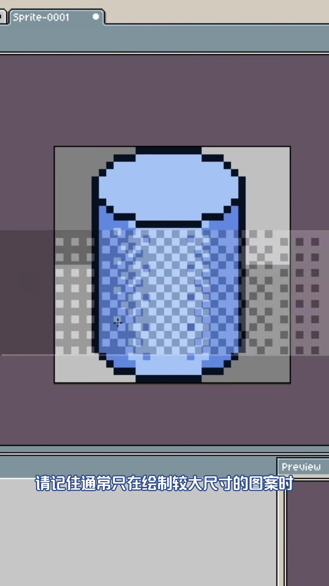
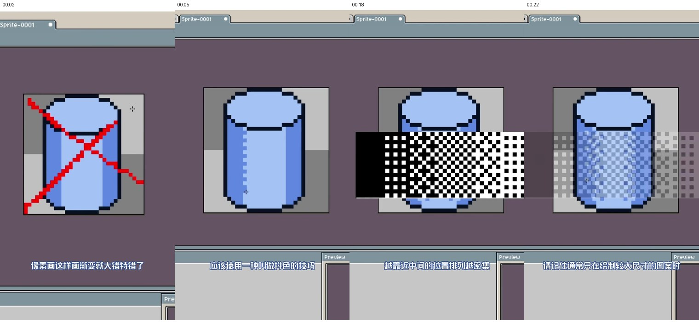

# 拒绝生硬过渡：一招画出完美的像素渐变

> 作者 **画生**（抖音）｜ 出处 **ThatCatWithOnly8Toes** ｜ 时长 **00:31** ｜ 竖屏 ｜ 点赞 14662 · 收藏 4529
> 原视频：https://www.douyin.com/video/7649641269047708934

## 一句话概括

像素画里**不要用平滑渐变**——颜色不够时会画成一圈圈硬色带；正确做法是**抖色（dithering）**：用两种颜色的像素点交替排列"骗"出中间色，而且**越靠近明暗交界处排列越密、往外侧逐渐变疏**。

## 30 秒版要点

- **错误示范一**：像矢量图那样拉一条对角线渐变 → 在像素画里直接看出斜纹，丑。
- **错误示范二**：退一步改成硬色带（banding）→ 过渡生硬，一眼假。
- **正解：抖色**。交替排列不同颜色的像素点营造中间色调，**特别适合可用颜色非常有限的情况**。
- **关键在密度**：越靠近中间（明暗交界）排列越密，向外侧慢慢降低密度。
- **适用条件**：通常只在**画较大尺寸的图案**时，或**调色板颜色很少**的时候才用。

## 分步拆解

### 1. 先看错的（00:02）

作者直接用一个圆柱体演示：按矢量思路做一条对角渐变，结果在像素网格上被量化成一条条斜纹——**过渡没出来，反而多了一层假纹理**。

把渐变简化成两三个色阶，又变成"硬色带"（banding）。这就是像素画最容易卡住的地方：**颜色不够，怎么调都不顺**。

### 2. 正解：抖色（00:18）

抖色（dithering）的思路是**不做颜色过渡，做密度过渡**：

| 位置 | 像素点排列 |
|---|---|
| 明暗交界处（中间） | 两种颜色的点**交替得最密**，视觉上混成中间色 |
| 往亮部/暗部走 | 密度逐渐降低，一方占据主导 |
| 两端纯色区 | 完全是一种颜色，不再堆点 |

所以它是用"点的密度"来模拟"颜色的中间值"——这也是为什么它**特别适合调色板很小的情况**：你不新增颜色，只重新安排已有的点。

### 3. 什么时候别用（00:21）

作者特意加了限制：

- 只在**画较大尺寸的图案**时用（小图塞不下点阵，会糊成一团噪点）
- 只在**调色板颜色很少**时用（颜色够多时，加一个中间色阶更干净）
- 滥用会让画面变成"电视雪花"，失去像素画该有的干净轮廓

## 抖色速查

| 项 | 做法 |
|---|---|
| 用什么 | 两种相邻颜色（如亮部色 + 暗部色）的像素点 |
| 怎么排 | checkerboard / 稀疏点阵，**交界面最密** |
| 密度怎么看 | 交界处约 50%:50%，向两侧递降到 0% |
| 什么时候用 | 大尺寸图案 + 调色板颜色少 |
| 什么时候别用 | 小图标、颜色充足、需要干净轮廓的主体 |

## 关键帧总览

## 可以直接带走的三条经验

1. **像素画的过渡是"排布问题"，不是"颜色问题"**：加不了颜色就改密度，这个思路能推广到阴影、光照、材质。
2. **交界最密、两侧渐疏**——记住这一条就不会把抖色画成均匀噪点。
3. **克制使用**：抖色是"穷的时候的解法"，颜色够就用色阶，别为了效果而效果。

---

完整口播文字稿（带时间点）见 `transcript.md`。
