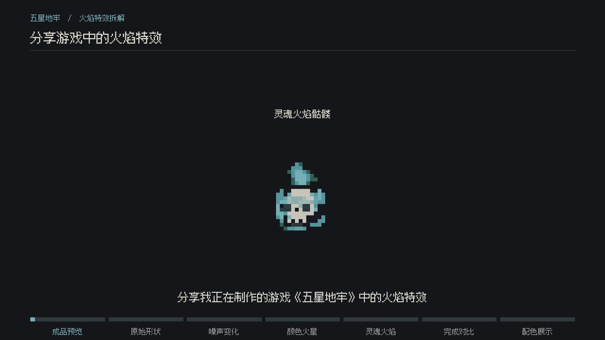
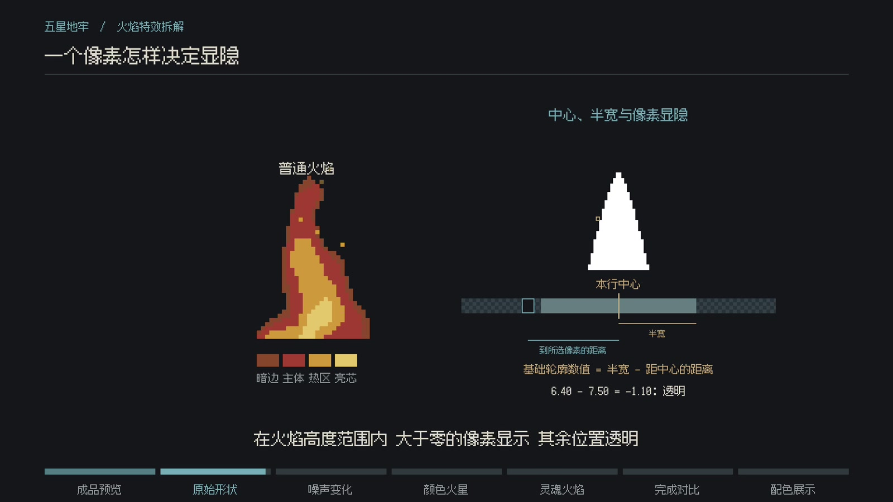
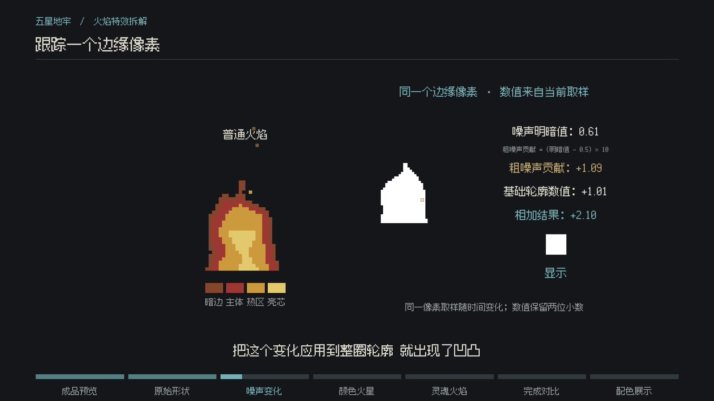
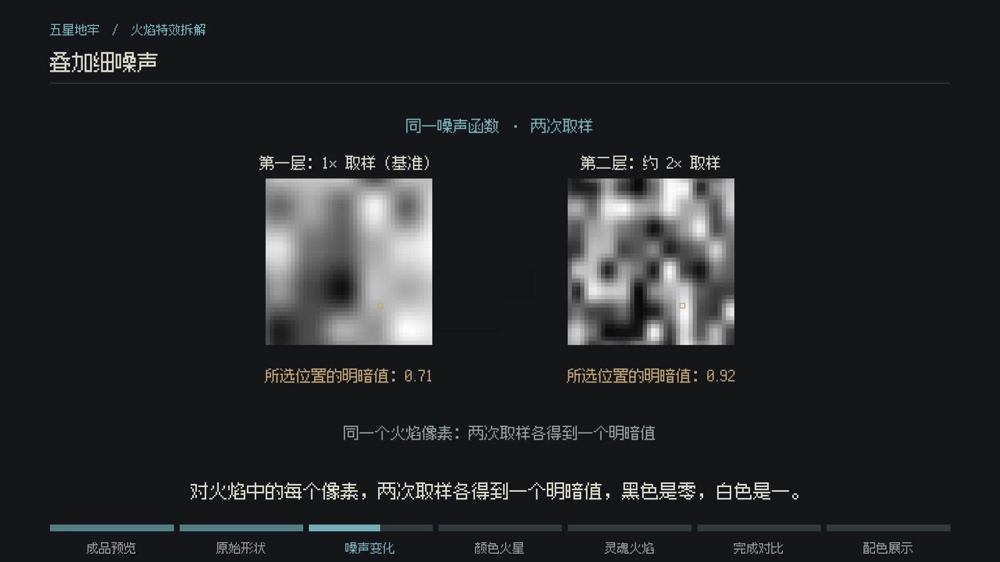
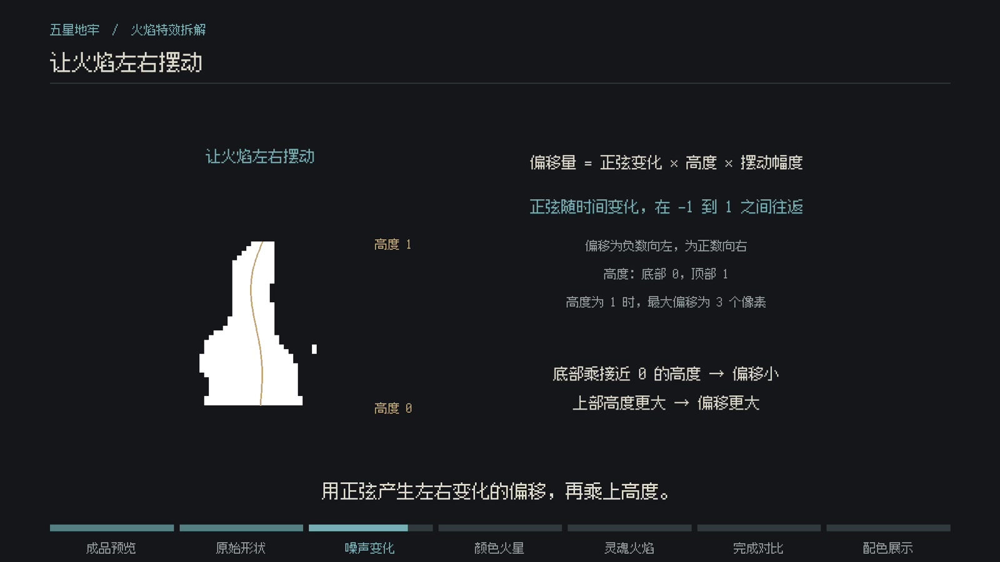
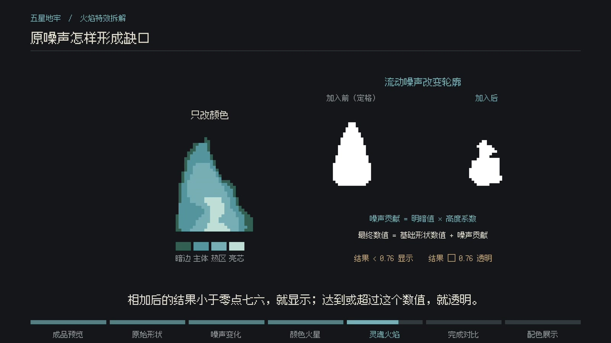
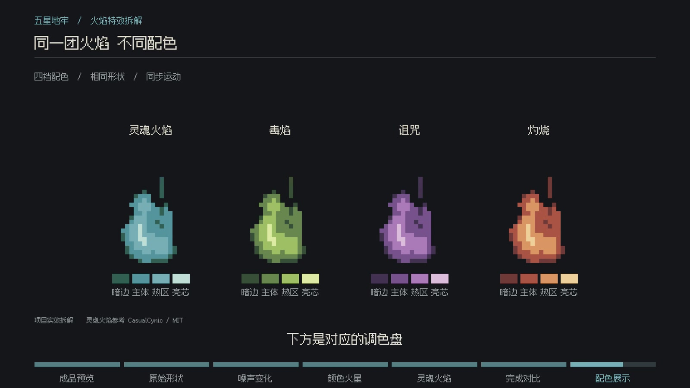
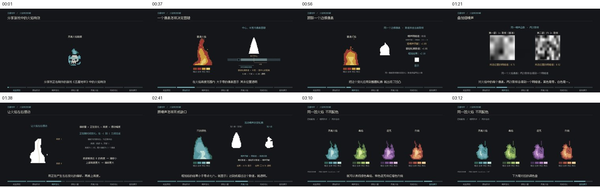

# 让火焰烧起来 ——《五星地牢》开发日志 04

> 作者 **babyunko** ｜ 时长 **03:17** ｜ 抖音 ｜ 点赞 2694 · 收藏 1986 · 评论 105
> 原视频：https://www.douyin.com/video/7689158160245973672

## 一句话概括

不靠逐帧贴图、也不靠粒子系统：把一张白色 PNG 轮廓转成「**每个像素一个数值**」，用两层滚动噪声把这个数值在 0 附近推来推去，正数显示、负数透明，火焰的形变、摆动、上色全部由这同一个数值驱动——最后换个调色盘就变成毒焰 / 诅咒 / 灼烧。

## 30 秒版要点

- **核心思路**：火焰不是一个"动画"，而是一道**每像素的判定题**。数值 > 0 就画这个像素，≤ 0 就透明。
- **形状**来自几何：`半宽 − 像素到本行中心的距离`，得到一个"里正外负"的基础轮廓。
- **形变**来自噪声：噪声值 −0.5 变成 ±0.5，加到轮廓数值上，轮廓就开始上下抖动出凹凸。
- **细节**靠第二层噪声：同一噪声函数用约 2 倍频率再采一次，强度更小（3 vs 10），做出更细的边缘毛刺。
- **摆动**靠改中心：按"高度"加权，用正弦给每一行的中心加水平偏移，底部几乎不动、越往上摆幅越大。
- **上色**复用同一个数值：按数值分段映射到 暗边 / 主体 / 热区 / 亮心 四档调色，再叠一层高度限制（热区仅在下方 70%、亮心仅在下方 35%）。
- **灵魂火焰**不是新系统：换形状 PNG + 换青蓝配色，把噪声乘上随高度增长的系数，判定阈值改成 `< 0.76 显示`，火舌自然断开成漂浮感。

## 分步拆解

### 1. 成品预览（00:00）



左边是最终效果，右边是同一套逻辑换色后的灵魂火焰。作者明确说了**先做普通火焰，再改成灵魂火焰**——两者共用一套管线，这点决定了后面所有的参数设计。

### 2. 一个像素怎么决定显隐（00:37）



这是全片的地基。把火焰的白色 PNG 当作"形状说明书"，对**每一行**取：

```
基础轮廓数值 = 半宽 − 像素到本行中心的距离
```

半宽就是"本行中心到左右边界的距离"。于是：

| 位置 | 数值 | 结果 |
|---|---|---|
| 轮廓内部 | 正数 | 显示 |
| 轮廓边界 | 0 | 边界 |
| 轮廓外部 | 负数 | 透明 |

### 3. 跟踪一个边缘像素：噪声怎么参与（00:56）



噪声图里黑色是 0、白色是 1，减 0.5 后变成 **−0.5 ~ +0.5** 的"成像强度"。加到轮廓数值上以后，原本刚好卡在 0 附近的边缘像素就会一会儿正、一会儿负——**边缘于是自己抖动起来**，凹凸就是这么来的。

### 4. 叠加细噪声 + 左右摆动（01:21 – 01:52）



第二层噪声不换函数，只换**取样频率**：第一层 1×、第二层约 2×，强度分别 10 和 3。两个明暗值各减 0.5 后加权相加，再并进轮廓数值。



摆动是**改中心而不是移动贴图**：

```
偏移量 = sin(时间) × 高度 × 摆幅
新中心 = 本行中心 + 偏移量
距离   = 像素 − 新中心          ← 用这个距离重算轮廓
```

高度在底部为 0、顶部为 1，所以火根几乎不动、火尖摆得最狠（最大 3 个像素）。

### 5. 上色与火星（01:52 – 02:20）

上色不另算一套遮罩，直接**复用决定显隐的那个数值**：数值落在哪一段，就取调色盘里哪一格——暗边 / 主体 / 热区 / 亮心。

额外只有一条高度规则：

| 层级 | 出现范围 |
|---|---|
| 热区 | 仅火焰下方 70% |
| 亮心 | 仅火焰下方 35% |

数值和高度**同时满足**才出颜色。火星则复用热区颜色（调色盘第三格），向上飘、后半程渐隐。

### 6. 灵魂火焰：改形状而非改逻辑（02:41）



三步得到"漂浮"感：

1. 把三角形 PNG 换成**目标形状**的 PNG（基础轮廓跟着变）
2. 关掉火星，暖色换**青蓝配色**
3. 噪声乘上**随高度增加的系数**再加到形状数值上，判定阈值改为 **`结果 < 0.76 显示`**（而不是 > 0）——于是噪声把轮廓"咬"出缺口，火舌之间的连接被切断

关键点：颜色仍然从**同一份计算结果**里取，所以轮廓一变，色块自动跟着走，不需要重画。

### 7. 一套逻辑四种火焰（03:10 – 03:12）



缩回游戏内实际显示尺寸后，形状和运动完全不变，**只换调色盘**就得到：

| 火焰 | 配色方向 |
|---|---|
| 灵魂火焰 | 青蓝 |
| 毒焰 | 绿色 |
| 诅咒 | 紫色 |
| 灼烧 | 红橙 |

这就是把"数值驱动"做彻底的好处：美术变体是数据，不是新代码。

## 可抄参数表

| 环节 | 公式 / 参数 |
|---|---|
| 基础轮廓 | `半宽 − 像素到本行中心距离`，>0 显示 |
| 噪声归一化 | `明暗值(0~1) − 0.5` → ±0.5 |
| 粗噪声强度 | × 10，取样倍率 1× |
| 细噪声强度 | × 3，取样倍率约 2× |
| 噪声动画 | 噪声图连续向下滚动 |
| 摆动 | `sin(t) × 高度 × 摆幅`，高度 1 时最大 3px |
| 上色分层 | 暗边 / 主体 / 热区 / 亮心（按数值区间） |
| 高度限制 | 热区 ≤ 下方 70%，亮心 ≤ 下方 35% |
| 火星 | 热区色（第 3 格），上升 + 后半程渐隐 |
| 灵魂火焰阈值 | `< 0.76 显示`，`≥ 0.76 透明` |

## 关键帧总览



## 可以直接带走的三条经验

1. **把"形状"和"动画"解耦**：形状是静态 PNG，动画是加到数值上的噪声，两者互不干扰，改形状不必重做动画。
2. **一个数值多用**：同一个判定值既管显隐、又管取色、还管热区亮心——少一层遮罩，就少一堆同步 bug。
3. **变体做成数据**：毒焰 / 诅咒 / 灼烧全靠换调色盘，说明只要把参数抽干净，美术成本可以降到接近零。

---

完整口播文字稿（带时间点）见 `transcript.md`。
